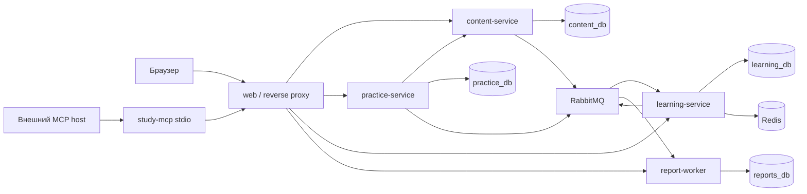

# Crucible

Технические имена, перенос данных и проверки переименования от 15 ноября 2026: [docs/rename.md](docs/rename.md).

Учебное приложение для подготовки по математике к магистратуре: задачи, редактор решений, теория, лаборатории и повторения. Приложение работает без LLM. Внешний агент обращается к предметным API через `study-mcp`.

Конспекты открываются по разделам с оглавлением и переходами назад/вперёд. В редакторе формула под курсором показывается во время ввода; парные символы и скобки закрываются автоматически. Таблицы и формулы поддерживаются также в конспектах и названиях навыков. Варианты выбора отображаются на странице без выпадающих списков.

Реализован исполняемый срез по ADR-003: три предметных сервиса, сервис экспорта, React-интерфейс, PostgreSQL, Redis и RabbitMQ. Активный банк содержит 57 карточек и 4 заметки из существующего Obsidian-vault: три конспекта и карту приёмов. История попыток пока синтетическая. Полная поставка P/D ещё не объявляется: оставшиеся требования перечислены в [статусе реализации](docs/implementation-status.md).

## Запуск

Для развёртывания нужны Docker Desktop/Engine, Compose **2.24.4+** и POSIX shell. Локальные Python, conda и Node не нужны. На этом Mac проверен Compose 2.39.4.

```sh
scripts/deploy
scripts/doctor
```

Откройте [локальное приложение](http://localhost:18080). Пароль владельца находится в `.secrets/owner-password`; подготовка не выводит его в логи. Порт 18080 выбран, чтобы не занимать распространённый порт 8080.

`scripts/deploy` создаёт или проверяет конфигурацию одноразовым контейнером из `compose.bootstrap.yaml`, запускает инфраструктуру и миграции, собирает приложения, загружает материалы только в пустую установку, при первом наполнении ждёт каталог в learning, применяет firewall для текущих адресов и выполняет doctor. Повторный запуск сохраняет секреты, попытки и активную публикацию. При неполной конфигурации подготовка останавливается без её автоматического исправления; при существующих volumes и отсутствии конфигурации новые пароли не создаются.

Make необязателен: `make up` вызывает `scripts/deploy`, `make setup` — только контейнерную подготовку, `make publish` — явную публикацию через API. Обновление файлов в `content/` само по себе не переключает активную публикацию:

```sh
scripts/deploy publish
scripts/firewall show
CRUCIBLE_DEMO=1 scripts/firewall test
scripts/doctor
```

Firewall применяется оператором через Docker CLI и NET_ADMIN probe в namespaces конкретных приложений. У приложений и NET_ADMIN probe нет Docker socket; privileged не используется. Сетевой тест восстанавливает прежние правила, включая аварийное завершение теста. Прямые `docker compose up/start` остаются низкоуровневыми командами; после пересоздания контейнеров повторите `scripts/deploy` для актуализации политики. Сетевое испытание выполняйте на синтетическом стенде.

Python, Node и браузеры также не нужны на хосте для проверок и операторских команд:

```sh
scripts/test unit
scripts/test integration
scripts/test e2e
CRUCIBLE_DEMO=1 scripts/test resilience
scripts/operator scripts/check_sql_isolation.py
scripts/assessment up
scripts/assessment status
CRUCIBLE_DEMO=1 scripts/operator scripts/backup.py
scripts/restore .private/backups/FILE.cruciblebackup --project crucible-restore-NEW --port 18082
```

Unit-тесты выполняются без сети, секретов и Docker socket; API-тесты получают API-сеть и синтетические credentials. E2E включает Node/Playwright и сохраняет исходный browser Origin через временный loopback proxy. Отказные, браузерные и интеграционные проверки запускайте последовательно только на синтетическом project.

`operator` — отдельный одноразовый административный контейнер с Docker CLI, checkout и Docker socket. Он имеет полномочия владельца Docker, а не sandbox-изоляцию; сайт, MCP и обычные тесты этого доступа не получают. Backup/restore, SQL isolation, failover/rejoin, replay и rebuild выполняются его Python внутри Linux-образа. Стандартный MCP-host запускает `scripts/study-mcp`: stdio передаётся в узкий MCP-контейнер с одним scoped secret и API-сетью.

Для желающего работать с Python непосредственно на компьютере остаются необязательные `make dev-setup` и `CRUCIBLE_LOCAL_PYTHON=1 scripts/python ...` (conda IAD, `.deps/`). Они не входят в обязательную процедуру установки или защиты.

[Полный ручной deploy с объяснением каждого этапа](docs/deployment.md) предшествует разбору обёрток в [инструктаже Obsidian](<docs/obsidian-demo/01 — Полный инструктаж.md>).

## Данные и архитектура



Каждый владелец использует собственную БД и роль. Сохранение попытки и её outbox фиксируются вместе; пересчёт происходит позже. Интерфейс различает сохранение и достижение нужного курсора learning. Опубликованный контент неизменяем, а старые попытки сохраняют свой снимок условия.

## Исходный vault

Исходные документы в `Task/` сохранены. Обследованы 57 карточек, 49 типов, 6 событий на 92 минуты. Приватная побайтовая копия с SHA-256 и lossless dry-run находятся в `.private/vault-2026-11-13/`. Эти данные и исходный vault не изменялись при разработке; личная история не импортирована в демонстрационные БД. Контрольные PDF скопированы в backup без извлечения содержимого и не включены в тренировки.

Все 57 карточек P-001–P-057 перенесены с условиями, тремя подсказками и решениями. Сгенерированные P-058–P-062 и прежние тексты теории сняты с активной публикации. Сохранены исходные типы; неоднозначные v2 aliases не применяются автоматически. Конспекты есть для 14 карточек, для остальных 43 интерфейс показывает отсутствие конспекта. Подробности и границы проверки: [происхождение материалов](docs/content-provenance.md).

## Эксплуатация и дальнейшая работа

- [Архитектура](docs/architecture.md), [владение данными](docs/service-ownership.md), [API](docs/api.md).
- [MCP: запуск](docs/mcp-setup.md), [совместимость](docs/mcp-compatibility.md).
- [Сети и firewall](docs/networking.md), [надёжность](docs/reliability.md), [сценарий показа](docs/demo-script.md).
- [Матрица приёмки и ограничения](docs/implementation-status.md).
- [Полный инструктаж для демонстрации в Obsidian](<docs/obsidian-demo/01 — Полный инструктаж.md>) — запуск, сценарий выступления, вопросы и свидетельства.

Локальный HTTP допустим только на loopback. Сетевое размещение требует HTTPS и отдельной эксплуатационной проверки. Приватные копии, секреты и результаты тестов исключены из Git. Не публикуйте `.private/` и `.secrets/`.
