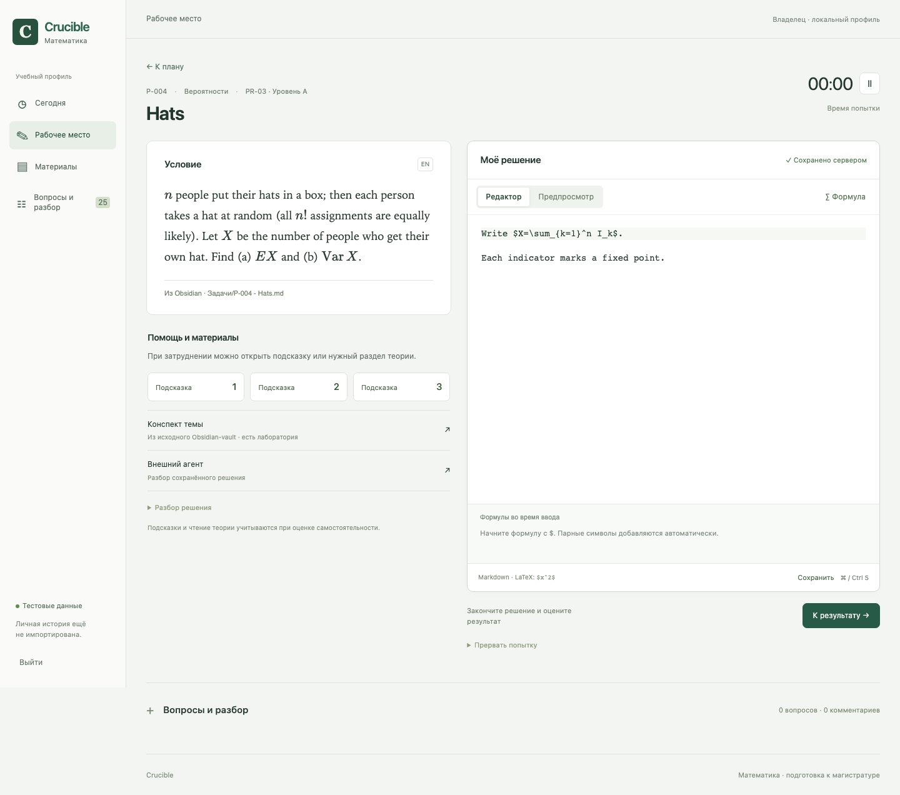
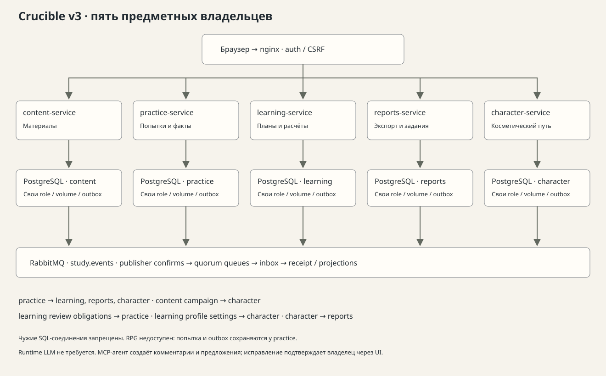

# Crucible

**Задачи, теория и повторение по результатам вашей работы.**

Crucible — локальное приложение для подготовки по математике к магистратуре. Оно объединяет задачи, черновики решений, конспекты и расписание повторений. Прогресс рассчитывается по результатам попыток и использованной помощи.

Приложение работает без встроенного LLM. Для разбора сохранённых решений можно подключить внешнего учебного агента через MCP.

## Возможности

- **Рабочее место задачи.** Условие и редактор рядом, Markdown и LaTeX, предпросмотр формул во время ввода, автосохранение и аварийная копия черновика в браузере.
- **Помощь по месту затруднения.** Последовательные подсказки, конспекты с оглавлением и интерактивные лаборатории; переход к материалу сохраняет текущую попытку.
- **План и повторения.** Дневной набор задач, объяснение выбора, история попыток и пересчёт прогресса по сохранённым результатам.
- **Разбор с агентом.** Вопросы, комментарии и предложения исправлений. Исправление подтверждает владелец через интерфейс.
- **Экспорт.** Фоновые задания формируют отчёты по снимкам данных сервисов.



*Демонстрационный профиль с синтетической историей.*

## Быстрый запуск

Нужны работающий **Docker Engine или Docker Desktop**, **Docker Compose 2.24.4+** и **POSIX shell**. Python и Node.js для контейнерного запуска устанавливать на компьютер не требуется.

Из корня репозитория выполните:

```sh
scripts/deploy
```

Откройте **[localhost:18080](http://localhost:18080)** и войдите с паролем из файла `.secrets/owner-password`.

При первом запуске команда создаёт конфигурацию, собирает образы, применяет миграции, публикует начальный каталог и проверяет сетевые правила и доступность API. Повторный запуск сохраняет существующие секреты и учебные данные. Исходный Obsidian-vault для запуска не нужен: опубликованные материалы находятся в `content/`.

| Действие | Команда |
|---|---|
| Запуск или обновление приложения | `scripts/deploy` |
| Проверка состояния API и firewall | `scripts/doctor` |
| Публикация изменений из `content/` | `scripts/deploy publish` |
| Остановка с сохранением данных | `docker compose stop` |

После остановки запускайте приложение снова через `scripts/deploy`, чтобы актуализировать firewall. Изменение файлов в `content/` требует отдельной публикации.

Подробности установки, конфигурации и ручного развёртывания — в [руководстве по развёртыванию](docs/deployment.md).

## Архитектура

Crucible разрабатывается как учебный проект по микросервисам и безопасности. Сервисы разделены по ответственности за материалы, факты учебной работы и расчёт прогресса.



Рамка `storage` объединяет сервис и его PostgreSQL. Метки `FW` обозначают firewall контейнеров: новые исходящие подключения разрешены только по списку адресов и портов. Стрелки показывают инициатора соединения; HTTP-вызовы и асинхронные подключения к RabbitMQ показаны отдельно. Подробнее — [сети и firewall](docs/networking.md).

| Компонент | Ответственность |
|---|---|
| `web` | React-интерфейс и reverse proxy |
| `content-service` | Задачи, теория и неизменяемые публикации материалов |
| `practice-service` | Попытки, черновики, время, факты помощи и разборы |
| `learning-service` | Прогресс, расписание повторений и дневные планы |
| `report-worker` | Задания экспорта и готовые артефакты |
| `study-mcp` | Доступ внешнего агента к предметным API через stdio |

Сервисы content, practice, learning и reports используют по отдельному контейнеру PostgreSQL со своими БД, ролями, volume и закрытой storage-сетью. [Перенос прежней установки и проверки изоляции](docs/database-isolation.md). Значимые факты и outbox записываются одной транзакцией; RabbitMQ доставляет события для последующего пересчёта. Redis используется как кэш. Начатая попытка сохраняет свою версию условия и не зависит от доступности планировщика при сохранении черновика.

**Стек:** Python / FastAPI, React / TypeScript, CodeMirror, KaTeX, PostgreSQL, RabbitMQ, Redis, nginx и Docker Compose.

[Архитектура](docs/architecture.md) · [Владение данными](docs/service-ownership.md) · [Контракты API](docs/api.md)

## Разработка и проверки

Команды для повторения демонстрационных проверок — в [scripts/demo](scripts/demo/README.md).

Изолированные unit-тесты запускаются в контейнере без сети, секретов и Docker socket:

```sh
scripts/test unit
```

Интеграционные, браузерные и отказные проверки изменяют учебные данные. Выполняйте их последовательно на отдельном синтетическом стенде; команды и порядок описаны в [руководстве по развёртыванию](docs/deployment.md) и [сценариях надёжности](docs/reliability.md).

Для локальной работы с Python используется conda-окружение `IAD`, зависимости проекта устанавливаются в `.deps/`:

```sh
make dev-setup
CRUCIBLE_LOCAL_PYTHON=1 scripts/python -m pytest -q
```

Для сборки интерфейса на компьютере с Node.js:

```sh
npm --prefix apps/web ci
npm --prefix apps/web run build
```

### Структура репозитория

| Путь | Содержимое |
|---|---|
| `apps/` | Backend-сервисы, MCP-адаптер и веб-интерфейс |
| `content/` | Публикуемые задачи, конспекты и метаданные |
| `packages/` | Общие контракты и технические библиотеки |
| `migrations/` | Миграции и схемы БД каждого сервиса |
| `infra/`, `compose*.yaml` | Образы, сети и конфигурация развёртывания |
| `scripts/` | Запуск, публикация, проверки и операторские команды |
| `tests/` | Проверки контрактов, владения данными, интеграции и отказов |
| `docs/` | Документация и публичные демонстрационные материалы |
| `Task/` | Требования и архитектурные решения |

## Текущее состояние

Проект находится в активной разработке и рассчитан на локальное использование одним владельцем. В каталоге — **57 карточек и 4 заметки** из существующего Obsidian-vault: три конспекта и карта приёмов. Конспекты связаны с 14 карточками; для остальных интерфейс явно показывает отсутствие материала. Личная история ещё не импортирована, демонстрационная история синтетическая.

Полная приёмка проекта ещё не завершена. В частности, подключение к выбранному пользовательскому MCP-host требует отдельного подтверждения. Реализованные сценарии, свидетельства проверок и оставшиеся требования перечислены в [статусе реализации](docs/implementation-status.md).

## Документация

| Тема | Руководство |
|---|---|
| Установка и эксплуатация | [Развёртывание](docs/deployment.md) |
| Внешний учебный агент | [Подключение MCP](docs/mcp-setup.md), [проверенная совместимость](docs/mcp-compatibility.md) |
| Безопасность | [Сети и firewall](docs/networking.md), [модель угроз](docs/threat-model.md) |
| Сохранность данных | [Backup, restore и отказные сценарии](docs/reliability.md) |
| Учебный контент | [Происхождение материалов и границы проверки](docs/content-provenance.md) |
| Демонстрация проекта | [Краткий сценарий](docs/demo-script.md), [подробный инструктаж Obsidian](<docs/obsidian-demo/01 — Полный инструктаж.md>) |
| Требования | [Предметные микросервисы](Task/ADR_003_Domain_Microservices.md), [границы MCP](Task/ADR_MCP_and_service_boundaries.md), [ТЗ](Task/TZ_Crucible.md) |

По умолчанию приложение доступно только через loopback; сетевое размещение требует HTTPS и отдельной проверки конфигурации. Секреты находятся в `.secrets/`, приватные копии и локальные свидетельства — в `.private/`. Эти каталоги исключены из Git и не входят в публичные материалы.
