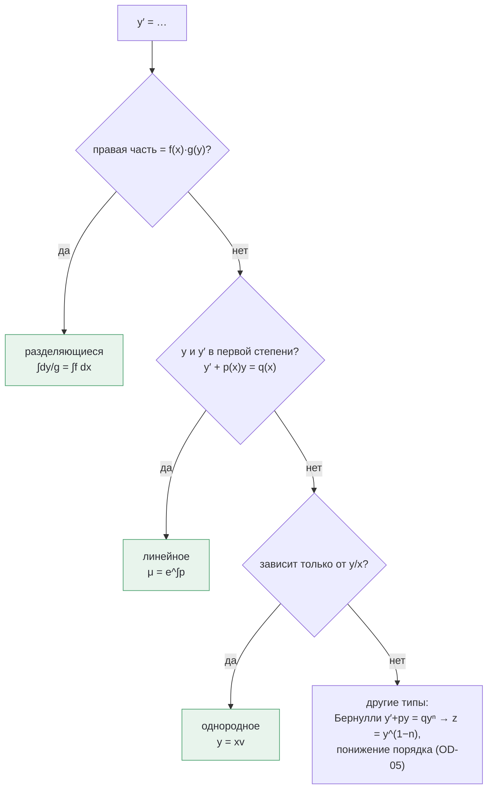

# Уравнения первого порядка

>
> Минимум, чтобы начать решать: что такое решение, три основных типа уравнений, как их узнать и что проверить в конце. Прочитать один раз перед первыми задачами по диффурам; потом — по ссылкам из подсказок.
>

## Что вообще ищем

> [!definition] Решение, общее решение, задача Коши
> **Дифференциальное уравнение первого порядка** связывает $x$, неизвестную функцию $y(x)$ и её производную: например, $y'=xy$.
> - **Решение** — функция, которая после подстановки обращает уравнение в тождество на некотором интервале.
> - **Общее решение** — формула со свободной константой $C$: она описывает все решения (иногда кроме отдельных «особых»).
> - **Задача Коши** — уравнение плюс начальное условие $y(x_0)=y_0$. Условие выбирает одно значение $C$.
> - **Интервал существования** — решение может «взорваться» на конечном $x$; ответ задачи Коши — функция на интервале, содержащем $x_0$.

> [!tip] Главная привычка
> **Проверяйте ответ подстановкой.** Продифференцировать и подставить — 30 секунд, и это ловит почти все ошибки в знаках и константах.

## Тип 1 · Разделяющиеся переменные

> [!definition] $y'=f(x)\,g(y)$
> Правая часть — **произведение** функции от $x$ и функции от $y$.
>
> **Метод.** $\dfrac{dy}{g(y)}=f(x)\,dx$ → $\displaystyle\int\frac{dy}{g(y)}=\int f(x)\,dx+C$ → выразить $y$, если получается.
>
> **Не потерять:** при делении на $g(y)$ теряются решения $y\equiv c$, где $g(c)=0$. Проверьте их отдельно.

> [!example] Пример
> $y'=x(1+y^2)$.
>
> > [!solution]- Решение
> > $\dfrac{dy}{1+y^2}=x\,dx$ → $\arctan y=\dfrac{x^2}2+C$ → $y=\tan\left(\dfrac{x^2}2+C\right)$. Делили на $1+y^2>0$ — решений не потеряли.

> [!intuition] Самое важное уравнение
> $y'=ky$ ⇒ $y=Ce^{kx}$. Это и рост/распад, и «кирпичик» всех линейных уравнений (MIT Матан 07, Theorem 7 — та же идея).

## Тип 2 · Однородные $y'=F(y/x)$

> [!definition] Правая часть зависит только от отношения $y/x$
> Признак: если заменить $x\to tx$, $y\to ty$, правая часть не меняется. Например, $\dfrac{x^2+y^2}{xy}$, $\dfrac yx+\tan\dfrac yx$.
>
> **Метод.** Замена $y=xv$, тогда $y'=v+xv'$. Уравнение становится $v+xv'=F(v)$, то есть $\dfrac{dv}{F(v)-v}=\dfrac{dx}x$ — разделяющиеся переменные для $v$.

> [!example] Пример
> $y'=\dfrac{y^2+xy}{x^2}$, $x>0$.
>
> > [!solution]- Решение
> > Правая часть — $v^2+v$ при $v=y/x$. Тогда $v+xv'=v^2+v$, $\dfrac{dv}{v^2}=\dfrac{dx}x$, $-\dfrac1v=\ln x+C$, то есть $y=-\dfrac{x}{\ln x+C}$. Потерянное при делении на $v^2$ решение: $v\equiv0$, то есть $y\equiv0$.

## Тип 3 · Линейные $y'+p(x)\,y=q(x)$

> [!definition] Линейное — $y$ и $y'$ входят в первой степени, без произведений
> **Метод интегрирующего множителя.**
> 1. $\mu(x)=e^{\int p(x)\,dx}$ (константу в показателе не пишем).
> 2. Умножить уравнение на $\mu$: левая часть **становится производной произведения**, $(\mu y)'=\mu q$, потому что $\mu'=p\mu$.
> 3. Проинтегрировать: $\mu y=\displaystyle\int\mu q\,dx+C$.
> 4. Поделить на $\mu$: $y=\dfrac1\mu\left(\displaystyle\int\mu q\,dx+C\right)$.
>
> **Константа $C$ добавляется до деления на $\mu$** — частая ошибка написать её в конце.

> [!example] Пример
> $y'+2y=e^x$.
>
> > [!solution]- Решение
> > $\mu=e^{2x}$, $(e^{2x}y)'=e^{3x}$, $e^{2x}y=\dfrac{e^{3x}}3+C$, $y=\dfrac{e^x}3+Ce^{-2x}$.

> [!intuition] Структура ответа
> Общее решение линейного уравнения = **одно частное решение** + **общее решение однородного** $y'+py=0$ (здесь $Ce^{-2x}$). Это верно для всех линейных уравнений, в том числе второго порядка — пригодится в OD-03.

## Как узнать тип

Одно уравнение может подходить под два типа: $y'=ky$ — и разделяющееся, и линейное. Выбирайте, что проще.

## Ловушки

> [!trap] Чаще всего ошибаются так
> - **Константа не там.** В линейном — до деления на $\mu$; в разделяющемся — одна $C$ на обе стороны.
> - **Потерянные решения** при делении на $g(y)$.
> - **Модули в логарифмах.** $\int\frac{dx}x=\ln|x|$; при $e^{\ln|y|}$ знак уходит в константу: $y=Ce^{\dots}$, $C$ любого знака.
> - **Интервал.** Ответ задачи Коши — на интервале, содержащем $x_0$, до первой особенности.
> - **Не проверили подстановкой.**

## Самопроверка

> [!quiz]- Четыре уравнения (новых, не из банка)
> 1. $y'=y^2$, $y(0)=1$. Найдите решение и интервал существования.
> 2. $xy'-y=x^2$, $x>0$.
> 3. $y'=\dfrac yx+\tan\dfrac yx$, $x>0$.
> 4. $y'=2xy+x$, $y(0)=0$.
>
> > [!success]- Ответы
> > 1. Разделяющееся: $-\frac1y=x+C$, $C=-1$: $y=\dfrac1{1-x}$ на $(-\infty,1)$.
> > 2. Линейное: $y'-\frac yx=x$, $\mu=\frac1x$, $\left(\frac yx\right)'=1$: $y=x^2+Cx$.
> > 3. Однородное: $v+xv'=v+\tan v$, $\frac{\cos v}{\sin v}dv=\frac{dx}x$: $\sin\dfrac yx=Cx$.
> > 4. Линейное (или разделяющееся: $y'=x(2y+1)$): $y=\dfrac{e^{x^2}-1}2$.

## Когда это нужно

| В условии | Тип | Первый ход |
|---|---|---|
| правая часть раскладывается в $f(x)g(y)$ | OD-01 | разделить переменные |
| правая часть — функция от $y/x$ | OD-01 | $y=xv$ |
| $y'+p(x)y=q(x)$, в том числе после деления на коэффициент при $y'$ | OD-02 | $\mu=e^{\int p}$ |

✦ Ядро темы для подготовки. Подробнее: В. И. Арнольд, Обыкновенные дифференциальные уравнения, гл. 1; MIT Диффуры — лекция 1 *(ссылка в исходном vault)*, лекция 4 *(ссылка в исходном vault)*, лекция 5 *(ссылка в исходном vault)*.
