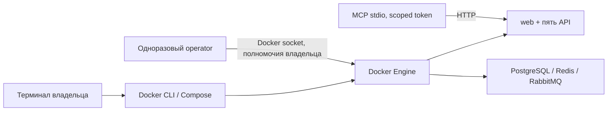

# Развёртывание Crucible: ручная процедура и автоматизация

Эта инструкция объясняет **что запускается, где выполняются команды и какие данные сохраняются**. Основной стенд рассчитан на один компьютер с Docker Engine/Desktop, Compose 2.24.4+ и POSIX shell. На macOS Linux-контейнеры выполняются в VM Docker Desktop. Python и Node входят в образы; устанавливать их на компьютер для описанных процедур не нужно.

## 1. Что находится на компьютере и внутри Docker

| Компонент | Где выполняется | Для чего нужен |
|---|---|---|
| Терминал / shell | На компьютере владельца | Передаёт команды Docker CLI; не выполняет backend Python |
| Docker CLI и Compose | На компьютере владельца | Читают YAML, отправляют build/create/start/exec в Docker Engine |
| Docker Engine / BuildKit | В Linux VM Docker Desktop либо на Linux-сервере | Собирают образы, создают namespaces, сети, mounts и volumes |
| web | Контейнер nginx | Отдаёт собранный React, проверяет сессию, проксирует API |
| content / practice / learning / reports / character | Пять контейнеров Python | Исполняют разные предметные контексты с собственными БД/ролями |
| PostgreSQL / Redis / RabbitMQ | Системные контейнеры | Хранят факты, ускоряют чтение, доставляют события |
| bootstrap / migrations / content-init | Одноразовые контейнеры | Подготавливают конфигурацию, SQL-схемы и первую публикацию |
| probe | Одноразовый операторский контейнер | Меняет только проектную цепь в network namespace выбранного приложения |
| operator | Отдельный административный контейнер | Запускает SQL-проверки, backup/restore, failover и rebuild через тот же Docker Engine |
| unit / integration / e2e / MCP | Отдельные контейнерные профили | Выполняют проверки или stdio-протокол без установки Python/Node на хост |

Образ — шаблон файловой системы и команды запуска. Контейнер — запущенный экземпляр образа. Сеть — отдельный объект Docker, а volume живёт дольше контейнера. Пересборка образа сама по себе не удаляет данные PostgreSQL.



У runtime-приложений, MCP и обычных тестов нет Docker socket. **Operator получает полный административный Docker-доступ**, эквивалентный Docker CLI владельца; это не sandbox и не сетевой сервис приложения. Он запускается явно, не входит в одиннадцать постоянных daily-контейнеров и удаляется после команды. Ни один новый Docker daemon внутри него не запускается. Этот доступ нужен, например, чтобы остановить primary или выполнить pg_dump в другом контейнере.

## 2. Ручной deploy через консоль

Далее приведена полная процедура **без scripts/deploy и Make**. Команды выполняются из корня checkout. На другом компьютере замени путь к проекту. Для текущей установки используй существующие .secrets и volumes; последовательность поддерживает повторный запуск.

### 2.1. Проверка среды и конфигурации

```sh
# Открываем checkout; все относительные bind mounts будут считаться от него.
cd /Users/ashentide/PycharmProjects/HighloadSecurity
# Проверяем связь CLI с Docker Engine, а не только наличие бинарника docker.
docker info
# Проверяем установленный Compose plugin.
docker compose version
# Проверяем синтаксис и объединение YAML без запуска контейнеров.
docker compose config --quiet
# Ограничиваем права новых приватных файлов текущей shell-сессии.
umask 077
# Готовим только каталоги; пароли здесь не задаются и не печатаются.
mkdir -p .secrets .private/evidence .private/backups
```

Имя project по умолчанию — crucible. COMPOSE_PROJECT_NAME переопределяет его; это меняет имена сетей/volumes и создаёт **другую установку**, а не переименовывает прежнюю. COMPOSE_FILE задаёт явный набор YAML; compose.override.yaml подхватывается Docker Compose автоматически при обычном запуске.

Если volumes прежнего project уже существуют, а .secrets потеряна, восстанови исходную конфигурацию. Генерация новых случайных паролей не изменит пароли уже созданных PostgreSQL/RabbitMQ. Автоматический deploy проверяет этот случай до генерации; при ручной работе это обязанность оператора.

### 2.2. Подготовка конфигурации отдельным контейнером

```sh
# Собираем инструмент и выполняем bootstrap без запуска основной системы.
docker compose -f compose.bootstrap.yaml run --rm --build bootstrap
```

Почему отдельный YAML: основной Compose ссылается на файлы секретов, которых при первой установке ещё нет. Bootstrap монтирует только каталог .secrets, не имеет сети и не получает Docker socket. Кратковременный root с CHOWN/DAC_OVERRIDE/FOWNER нужен для установки файлов и сохранения host-владельца; это описанное операторское исключение, а не режим API.

В scripts/setup.py происходят следующие действия:

1. Берётся файловая блокировка .bootstrap.lock — две подготовки не должны одновременно генерировать разные пароли.
2. При существующем комплекте проверяются обязательные файлы, JSON, соответствие ключей Ed25519, password hash и подписи/сроки клиентских JWT. Содержимое не переписывается.
3. Для пустой установки создаются owner password, Argon2id hash, ключи подписи, отдельные runtime/migration-роли и AMQP credentials каждого владельца, Redis ACL и scoped JWT клиентов.
4. Четыре отдельных PostgreSQL init SQL создают каждый свою БД и runtime/migration-роли. Для каждого контейнера генерируется собственный пароль администратора. RabbitMQ definitions задают пользователей, exchanges, quorum queues и bindings. Это конфигурация инфраструктуры, а не импорт попыток.
5. Сначала проверяется подготовленный временный комплект, затем файлы устанавливаются в .secrets. Неполная конфигурация останавливает подготовку вместо автоматической замены паролей.

Каталог .secrets имеет 0700. Новые bind-mounted runtime-конфигурации читаемы разными UID системных контейнеров только через выданные им mounts; пароль владельца и lock — 0600. Не открывай созданные JSON и SQL на проекторе: они содержат реальные credentials. Для объяснения показывай исходный setup.py и эту схему.

### 2.3. Сборка образов

```sh
# Probe содержит Python stdlib и iptables; NET_ADMIN выдаётся только при запуске.
docker build -f infra/Dockerfile.probe -t crucible-probe:0.2.0 .
# Собираем собственные образы API, web и одноразовых задач.
docker compose build content practice learning reports character web migrations content-init
```

Dockerfile.api начинает с зафиксированного Python 3.11 image digest, устанавливает requirements.lock, копирует технические пакеты и только выбранный предметный сервис, переключается на UID 10001 и запускает uvicorn. ARG SERVICE выбирает каталог на **этапе сборки**; отдельные сервисы получают разные образы.

Dockerfile web имеет два этапа: Node выполняет npm ci и build; конечный nginx получает только dist и proxy-конфигурацию. Node и TypeScript не остаются сервером production UI. .dockerignore исключает .private, .secrets, host .deps, node_modules, outputs, исходные Task и результаты тестов из build context.

RUN выполняется при сборке слоя образа, CMD — при старте контейнера. При неизменном lock-файле слой зависимостей используется из build cache. --build не означает удаление volumes и не гарантирует, что уже работающий контейнер автоматически заменился до команды up.

### 2.4. Запуск инфраструктуры и SQL-миграций

```sh
# Создаём именованные volumes и ждём готовности БД, cache и broker.
docker compose up -d --wait --wait-timeout 180 postgres-content postgres-practice postgres-learning postgres-reports postgres-character redis rabbitmq
# Запускаем одноразовый migration-процесс после здорового PostgreSQL.
docker compose up -d migrations
# Проверяем его настоящий код завершения: успешная задача должна закончиться с 0.
docker compose wait migrations
# Показываем, какие версии применены, без вывода credentials.
docker compose logs migrations
```

-d оставляет контейнеры в фоне, --wait ждёт healthcheck, --wait-timeout ограничивает ожидание. pg_isready проверяет доступность PostgreSQL; RabbitMQ diagnostics — процесс брокера. Redis healthcheck наблюдает ожидаемый NOAUTH у закрытого default user: отсутствие анонимного доступа здесь нормально.

При пустом собственном postgres-<owner>-data официальный PostgreSQL entrypoint выполняет init SQL из Compose secret. При повторном запуске непустого volume init SQL заново не исполняется. Поэтому новый файл с паролем не является командой смены пароля существующей БД.

scripts/migrate.py подключается отдельными migration credentials к каждой собственной БД, создаёт schema_migrations, сравнивает SHA-256 уже применённых файлов, выполняет новые нумерованные SQL и выдаёт runtime-роли только нужные DML-права. Изменение уже применённого SQL отвергается. При ошибке транзакция этой БД откатывается; API не должны запускаться поверх неподтверждённой миграции.

Exited (0) у migrations — правильное состояние. Ожидать от одноразовой задачи постоянно работающего healthy-процесса неверно; для неё применяется service_completed_successfully.

### 2.5. Backend и firewall до ожидания API

```sh
# Создаём пять network namespace, не запуская их зависимости повторно.
docker compose up -d --no-deps content practice learning reports character
# Сохраняем metadata только контейнеров текущего project в закрытый файл.
docker inspect $(docker compose ps -q) > .private/evidence/manual-network.json
# Metadata читается внутри отдельного probe; родительский приватный каталог остаётся закрыт.
chmod 644 .private/evidence/manual-network.json
# Применяем правила к пяти уже работающим backend namespaces.
for crucible_service in content practice learning reports character; do
  # ID приходит от Compose, а не из произвольного пользовательского текста.
  crucible_cid=$(docker compose ps -q "$crucible_service")
  # Probe разделяет только сеть выбранного контейнера; Docker socket ему не выдаётся.
  docker run --rm --pull=never --network "container:$crucible_cid" --cap-drop ALL --cap-add NET_ADMIN --security-opt no-new-privileges:true --read-only --tmpfs /tmp --mount "type=bind,source=$PWD/.private/evidence/manual-network.json,target=/metadata.json,readonly" crucible-probe:0.2.0 python /opt/firewall.py apply --source "$crucible_service"
done
```

Здесь --no-deps допустим: инфраструктура и миграции уже проверены предыдущими шагами. Прежде чем ожидать health API, нужно актуализировать старые разрешённые IP: после recreate PostgreSQL адрес мог измениться, а старый firewall не должен бессрочно блокировать восстановление.

Probe проверяет Compose labels, вычисляет реальные адреса целей и атомарно обновляет свою цепь через iptables-restore --noflush. Чужие цепи не очищаются. В OUTPUT приложения устанавливается единственный первый переход в CRUCIBLE_EGRESS. Это Linux netfilter в VM Docker Desktop, а не firewall macOS.

Политика включает loopback, ESTABLISHED/RELATED, адреса и порты из матрицы, затем REJECT остальных соединений. Для learning разрешены PostgreSQL:5432, RabbitMQ:5672 и Redis:6379. Runtime имеет только собственную storage-сеть и разрешение на собственный PostgreSQL IP. SQL-права внутри экземпляра проверяются отдельным уровнем.

Ниже — фактический смысл правил learning. Адреса должны быть взяты из текущего inspect, а не переписаны со старого скриншота:

```text
OUTPUT → CRUCIBLE_EGRESS
  -o lo                                      ACCEPT
  --ctstate ESTABLISHED,RELATED               ACCEPT
  -d <postgres-learning-IP> -p tcp --dport 5432        ACCEPT
  -d <rabbitmq-IP> -p tcp --dport 5672        ACCEPT
  -d <redis-IP> -p tcp --dport 6379           ACCEPT
  остальное                                  REJECT
```

Для просмотра настоящих правил и счётчиков одного namespace без обёртки:

```sh
# Находим работающий контейнер learning.
crucible_learning=$(docker compose ps -q learning)
# Читаем Linux-цепь того же namespace отдельным административным probe.
docker run --rm --network "container:$crucible_learning" --cap-drop ALL --cap-add NET_ADMIN crucible-probe:0.2.0 iptables -nvxL CRUCIBLE_EGRESS
```

### 2.6. Начальная публикация и web

```sh
# Compose ждёт backend health, выполнение content-init и готовность web.
docker compose up -d --wait --wait-timeout 180
# Показываем outcome начальной публикации: release ID и catalog sequence.
docker compose logs content-init
# Показываем работающие компоненты и одноразовые задачи, включая Exited (0).
docker compose ps --all
```

content-init использует только API content, scoped operator token и read-only файлы content. Если активная публикация уже есть, она сохраняется: изменённые авторские файлы не активируются от простого restart. Для пустой установки создаётся команда с command_id, API валидирует bundle и фиксирует immutable release, command receipt и outbox в одной транзакции. Publisher передаёт событие RabbitMQ; learning записывает собственную проекцию. Первичная инициализация ждёт достижения нужного каталога learning. Существующая установка может догонять retained outbox после restore асинхронно.

web зависит от успешного content-init и health четырёх учебных API; character имеет независимую readiness. Это порядок начального запуска, а не постоянный мониторинг зависимостей Compose. После старта отказ broker/cache не должен запрещать сохранение practice: readiness API проверяет собственную БД, а факты и outbox фиксируются локально.

### 2.7. Политика web и итоговая проверка

```sh
# Обновляем metadata после появления нового namespace web.
docker inspect $(docker compose ps -q) > .private/evidence/manual-network.json
# Metadata читается внутри отдельного probe; родительский приватный каталог остаётся закрыт.
chmod 644 .private/evidence/manual-network.json
# Повторяем установку для всех пяти приложений и сразу сверяем её с текущими IP.
for crucible_service in web content practice learning reports character; do
  # Получаем ID актуального экземпляра, а не имя старого контейнера.
  crucible_cid=$(docker compose ps -q "$crucible_service")
  # Устанавливаем ровно проектную политику этого namespace.
  docker run --rm --pull=never --network "container:$crucible_cid" --cap-drop ALL --cap-add NET_ADMIN --security-opt no-new-privileges:true --read-only --tmpfs /tmp --mount "type=bind,source=$PWD/.private/evidence/manual-network.json,target=/metadata.json,readonly" crucible-probe:0.2.0 python /opt/firewall.py apply --source "$crucible_service"
  # Проверяем наличие, состав правил и первый переход OUTPUT→CRUCIBLE_EGRESS.
  docker run --rm --pull=never --network "container:$crucible_cid" --cap-drop ALL --cap-add NET_ADMIN --read-only --mount "type=bind,source=$PWD/.private/evidence/manual-network.json,target=/metadata.json,readonly" crucible-probe:0.2.0 python /opt/firewall.py check --source "$crucible_service"
done
# Проверяем доступность gateway с хоста через единственный опубликованный порт.
curl -fsS http://127.0.0.1:28080/hello
# Контейнерный диагностический клиент читает настоящие предметные API.
docker compose run --rm --no-deps tools scripts/doctor.py --require-ready
```

На хост опубликован только 127.0.0.1:28080 → nginx:8080; backend слушают 8000 только внутри сетей, PostgreSQL/Redis/AMQP не опубликованы. Правила и пробы относятся к IPv4 текущего Compose. До успешной проверки всей процедуры стенд не считается готовым; ручной запуск содержит короткое локальное служебное окно между созданием namespace и установкой правил.

Для порта, изменённого overlay-файлом, используй фактический host port и соответствующий CRUCIBLE_ORIGIN при bootstrap. В контейнерном HTTP-запросе localhost означает сам контейнер, поэтому tools/MCP обращаются к web:8080. Operator при необходимости присоединяет **себя** к API-сети целевого project и использует уникальное имя его web-контейнера; source и restore не путаются.

## 3. Повторный запуск, обновление и остановка

| Команда | Что делает | Что происходит с данными |
|---|---|---|
| docker compose build | Создаёт новые образы из checkout | Volumes не удаляются |
| docker compose start | Запускает прежние контейнеры | Старые образы и volumes остаются; health ожидания нет |
| docker compose up -d --wait | Создаёт/сверяет контейнеры и ждёт начальной готовности | Volumes переиспользуются; firewall после recreate нужно обновить |
| docker compose restart learning | Перезапускает прежний контейнер | Не применяет новую конфигурацию YAML или новый образ автоматически |
| docker compose stop | Останавливает процессы | Контейнеры и volumes сохраняются |
| docker compose down | Удаляет контейнеры и сети project | Именованные volumes по умолчанию сохраняются |
| docker compose down --volumes | Удаляет также volumes этого project | Данные БД/брокера удаляются; допустимо только для собственного одноразового синтетического стенда |

Для обычной остановки используй stop. Полный деплой сохраняет конфигурацию, применённые миграции, попытки и активную публикацию. Прямой up/start не является контроллером firewall: он не следит за сменой IP и не ставит правила за оператора.

Новая редакция контента публикуется явно: контейнер tools запускает scripts/publish.py через content API. Новая версия материала не меняет snapshot старой попытки. Полный rollback кода не сводится к смене image tag, если уже применена несовместимая SQL-миграция; её совместимость нужно проверять отдельно.

## 4. Ручные команды тестов и MCP

```sh
# Выбираем API-сеть именно текущего daily project.
export CRUCIBLE_TARGET_PROJECT="$(docker compose config --format yaml | sed -n 's/^name: //p')"
# Запускаем unit-тесты без сети, секретов, Docker socket и host Python.
docker compose -f compose.tasks.yaml -p crucible-tasks run --rm --build -T unit-tests
# Интеграционные тесты получают read-only synthetic credentials и API-сеть.
docker compose -f compose.tasks.yaml -p crucible-tasks run --rm --build -T integration-tests
# Собираем узкий образ MCP-адаптера.
docker compose build study-mcp
# Передаём JSON-RPC по stdin/stdout без TTY; процесс ждёт клиента MCP.
docker compose run --rm -T --no-deps study-mcp
```

Для браузерной проверки без обёртки также нужно явно выбрать существующий namespace web:

```sh
# Сохраняем ID уже работающего web; это не команда его пересоздания.
export CRUCIBLE_WEB_CONTAINER="$(docker compose ps -q web)"
# Используем тот же Origin, который был установлен bootstrap (здесь стандартный порт).
CRUCIBLE_ORIGIN=http://127.0.0.1:28080 docker compose -f compose.yaml -f compose.e2e.yaml run --rm --build -T --no-deps e2e
```

Последняя команда сама по себе не открывает чат: MCP-host должен выполнить initialize, list_tools и вызовы по протоколу. SDK-тест запускает отдельный настоящий stdio-процесс, но не подтверждает регистрацию в конкретном desktop-host. При подключении через scripts/study-mcp build-диагностика идёт в stderr, stdout занят протоколом.

Браузерный профиль e2e содержит Playwright, Node и версии браузеров, совпадающие с package-lock. Он использует network namespace web и временный loopback-прокси, чтобы browser Origin оставался localhost с настроенным портом. Прокси не публикует новый порт хоста и завершается вместе с тестом. E2E и интеграционные проверки создают синтетические попытки; выполнять их следует на отдельном project.

## 5. Явные операторские команды

Обычные тесты и MCP не имеют Docker socket. Следующий профиль — **административный**, его нужно уметь отличать на защите:

```sh
# Совпадение абсолютного пути требуется вложенным Docker bind mount операциям.
export CRUCIBLE_PROJECT_DIR="$PWD"
# Указываем source project, которым будет управлять операторская программа.
export CRUCIBLE_TARGET_PROJECT="$(docker compose config --format yaml | sed -n 's/^name: //p')"
# Собираем Python + Docker CLI; daemon остаётся прежним внешним Docker Engine.
docker compose -f compose.tasks.yaml -p crucible-tasks build operator
# Проверяем собственные SQL-права пяти владельцев и безопасный CRUD черновика.
docker compose -f compose.tasks.yaml -p crucible-tasks run --rm -T --no-deps operator scripts/check_sql_isolation.py
# На синтетическом стенде создаём согласованный зашифрованный backup пяти БД.
CRUCIBLE_DEMO=1 docker compose -f compose.tasks.yaml -p crucible-tasks run --rm -T --no-deps operator scripts/backup.py
```

Operator монтирует checkout по тому же абсолютному пути и Docker socket. Поэтому созданный им новый Compose project ссылается на **host-пути**, а не на несуществующий для daemon внутренний /app. read_only защищает его образ, но bind mount проекта намеренно доступен для записи отчётов, backup и восстановленной конфигурации. Ограниченные Linux capabilities не отменяют административных возможностей Docker socket.

Backup останавливает все приложения-писатели/consumers, создаёт пять pg_dump, manifest и checksums, шифрует AES-GCM отдельным ключом и возвращает приложения с актуальными правилами. Restore принимает только новый project, проверяет архив и таблицы до старта приложений, затем повторяет retained outbox и ждёт актуальную проекцию. Это не замена реальной проверке восстановления.

Assessment использует отдельные volumes, primary/standby и три RabbitMQ с quorum queues. Он наследует тот же предметный код; переключение выполняется оператором с fencing, а не называется автоматическим. После прежнего failover имя standby может обозначать текущий primary — роли нужно читать через pg_is_in_recovery(). Rejoin сначала пытается выполнить pg_rewind. Если нужный WAL уже удалён и rewind не завершился, старый узел остаётся fenced: сначала выполняются новый pg_basebackup и pg_verifybackup, прежний каталог сохраняется под .pre-rejoin внутри закрытого volume, затем устанавливается новая копия и включается standby.signal. Только после возврата и sync-проверки узел считается репликой. Эта ветка следует [правилу восстановления после ошибки pg_rewind](https://www.postgresql.org/docs/17/app-pgrewind.html); сохранённая старая копия требует отдельного обслуживания, автоматического retention нет.

## 6. Автоматизация после понимания ручных шагов

scripts/deploy выполняет описанную последовательность, сохраняет коды завершения и добавляет проверки конфигурации/volumes. Для уже собранного operator допустим CRUCIBLE_BUILD_TOOLS=0: это ускоряет повторный показ и позволяет использовать образ без повторного обращения к registry. Make даёт короткие имена тем же командам. Он не является отдельной системой контейнеризации.

| Задача | Команда без Make |
|---|---|
| Полный daily deploy и firewall | scripts/deploy |
| Проверка правил и API | scripts/doctor |
| Явная публикация контента | scripts/deploy publish |
| Unit / API / browser tests | scripts/test unit / integration / e2e |
| Синтетические отказные тесты | CRUCIBLE_DEMO=1 scripts/test resilience |
| Assessment | scripts/assessment up / status / postgres-failover / rejoin / rabbit-failover |
| Backup | CRUCIBLE_DEMO=1 scripts/operator scripts/backup.py |
| Restore | scripts/restore BACKUP --project crucible-restore-NEW --port 18082 |
| SQL isolation | scripts/operator scripts/check_sql_isolation.py |
| Rebuild / replay | CRUCIBLE_DEMO=1 scripts/operator scripts/rebuild_learning_projections.py; scripts/operator scripts/replay_outbox.py --service practice |
| MCP host | scripts/study-mcp |

В [полном инструктаже Obsidian](<obsidian-demo/01 — Полный инструктаж.md>) далее приведены исходники обёрток с построчными комментариями. Их выполняемые строки соответствуют ручным шагам выше; код Python внутри образов показывает предметную часть соответствующей операции. Любую ошибку нужно объяснять по последнему подтверждённому шагу, а не повторять setup с удалением секретов.

## 7. Первичные технические источники

- [Docker Compose: порядок запуска и одноразовые зависимости](https://docs.docker.com/compose/how-tos/startup-order/).
- [Docker Compose run: отдельный процесс, --rm и --no-deps](https://docs.docker.com/reference/cli/docker/compose/run/).
- [Docker Engine: полномочия daemon и доверительная граница](https://docs.docker.com/engine/security/).
- [Playwright Docker: браузеры, системные зависимости и согласование версий](https://playwright.dev/docs/docker).
