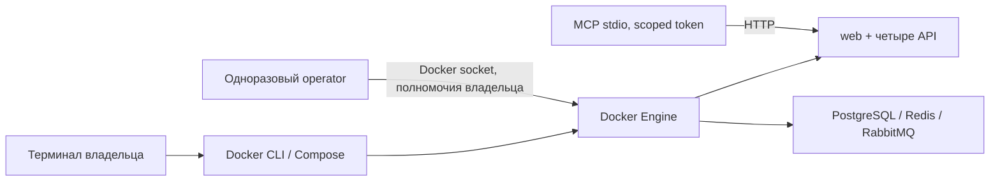
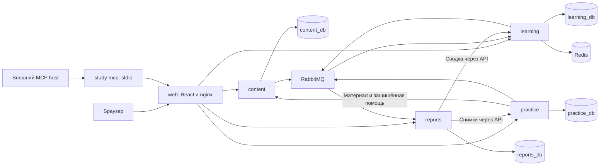
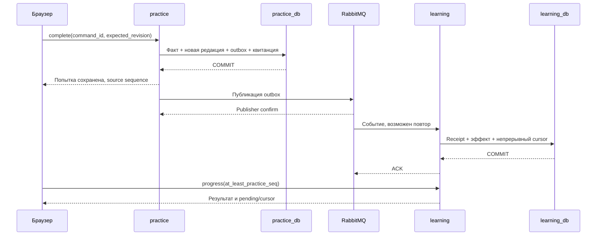

---

> Обновление топологии: каждому доменному сервису выделен отдельный PostgreSQL, volume и storage-сеть. Команды и свидетельства общего кластера ниже относятся к прежнему стенду. Текущая схема и проверки: [изоляция БД](../database-isolation.md), [надёжность](../reliability.md).
title: Crucible — полный инструктаж для демонстрации
aliases:
  - Инструктаж Crucible
  - Подготовка к защите
tags:
  - crucible/demo
  - highload/security
  - runbook
created: 2026-11-14
updated: 2026-11-14
status: Готово к репетиции
project: Crucible
local_url: http://localhost:18080
---

# Crucible — полный инструктаж

> [!abstract] Что здесь находится
> Инструкция для владельца проекта: как запустить приложение, войти, пройти пользовательский сценарий, объяснить архитектуру и показать инфраструктуру по запросу преподавателя. Основное выступление рассчитано на **5 минут**. Аварийные испытания — отдельная расширенная демонстрация.

**Навигация:** [[05 — Происхождение материалов]] · [[02 — Сценарий на 5 минут]] · [[03 — Вопросы преподавателя]] · [[04 — Проверки и свидетельства]]

## Как пользоваться в Obsidian

1. Перенеси **всю папку `obsidian-demo`**, включая `attachments`, в удобное место своего vault. Можно открыть эту папку как отдельное хранилище.
2. Открой эту заметку в режиме чтения. Включи встроенные панели **«Структура / Outline»** и **«Обратные ссылки / Backlinks»**, если ими пользуешься.
3. Нажимай на внутренние ссылки, например [[02 — Сценарий на 5 минут]]; ссылка на заголовок переводит сразу к нужной процедуре. При наведении с `Ctrl`/`Cmd` можно посмотреть предпросмотр, если включён встроенный Page preview.
4. Callout с `+` или `-` рядом с типом раскрывается и сворачивается. Флажки в чек-листах сохраняют ход твоей подготовки.
5. Скриншоты, таблица доказательств и сценарий встроены обычными средствами Obsidian. **Dataview, Templater и сторонние плагины не нужны.**

> [!note]- Что зависит от компьютера
> Внутренние ссылки и вложения переносимы вместе с папкой. Команды ниже рассчитаны на текущий Mac и каталог `/Users/ashentide/PycharmProjects/HighloadSecurity`. На другом компьютере замени этот путь и подготовь Docker с Compose. Для daily-деплоя локальный Python не требуется; Python IAD остаётся необязательным режимом локальной разработки; MCP, тесты и операторские команды также запускаются в контейнерах. Пароль и токены в комплект заметок не включены.

%% Личное поле для репетиции: впиши свои формулировки и отметь команды, которые уже выполнил. Этот комментарий скрыт в режиме чтения. %%

## Оглавление

- [[#1. Что мы показываем]]
- [[#2. Развёртывание и повторный запуск]]
- [[#3. Вход на сайт]]
- [[#4. Полный пользовательский маршрут]]
- [[#5. Как объяснить архитектуру]]
- [[#6. База, кеш и брокер — отдельные доказательства]]
- [[#7. Деградация без потери попытки]]
- [[#8. Сегментация и настоящий firewall]]
- [[#9. PostgreSQL и RabbitMQ в assessment]]
- [[#10. Резервное копирование и восстановление]]
- [[#11. Внешний агент и MCP]]
- [[#12. Автоматические проверки]]
- [[#13. Подготовка к выступлению и завершение]]
- [[#14. Если что-то пошло не так]]
- [[#15. Где искать код и подробности]]

## 1. Что мы показываем

**Crucible — персональное приложение для математической практики.** Пользователь начинает с задачи, сохраняет свой ход, при затруднении открывает конкретную теорию или лабораторию, возвращается к той же попытке и фиксирует результат. Повторения рассчитываются по сохранённым результатам и использованной помощи.
^position

> [!important] Формулировка готовности
> Это **работающий демонстрационный срез**. Сейчас есть **57 карточек, три конспекта и карта приёмов из Obsidian**. Полная программа и полная готовность релизов P/D ещё не заявлены. История на сайте синтетическая; личная история из Obsidian пока не импортирована.

### Состояние, проверенное при подготовке инструкции

**14 ноября 2026, после обновления деплоя:** основной стенд работает; контейнерный doctor получил HTTP 200 от content, practice и learning, а проверка подтвердила актуальные правила всех пяти приложений. Новый снимок — [health-deploy-2026-11-14.json](attachments/health-deploy-2026-11-14.json). Курсоры относятся к моменту снимка и меняются после следующих действий. Старый health-2026-11-14.json сохраняется как предыдущая проверка.

| Стенд | Compose project | Адрес | Состояние на момент проверки |
|---|---|---|---|
| Основной, daily | Имя из `compose.yaml` | [localhost:18080](http://localhost:18080) | Работает; используется для показа продукта |
| Расширенный, assessment | `crucible-assessment` | [localhost:18081](http://localhost:18081) | Остановлен; данные и результаты испытаний сохранены |
| Проверенное восстановление | `crucible-restore-final` | [localhost:18082](http://localhost:18082) | Остановлено; отдельные volumes сохранены |

В daily **8 постоянно работающих контейнеров**: 5 приложений и 3 инфраструктурных компонента. `migrations` и `content-init` — одноразовые контейнеры; их `Exited (0)` означает успешное выполнение. Bootstrap, tools и firewall probe также одноразовые. В assessment — **11 постоянных контейнеров**: добавлены PostgreSQL standby и два RabbitMQ-узла.

### Что уже работает

| Возможность | Что можно показать |
|---|---|
| Вход владельца | Пароль, сессия, выход; публичной регистрации нет |
| Сегодня | Сохранённый план, причины выбора задач, настройки числа задач и часового пояса |
| Попытка | Один текущий сеанс, серверный черновик, пауза/продолжение, LaTeX |
| Помощь | Три подсказки, ядро темы, теория, лаборатория, решение; помощь учитывается |
| Результат | Самооценка каждой части, рефлексия, пересчёт повторений |
| Вопросы | Вопрос к конкретной попытке, переход к контексту, закрытие владельцем |
| Комментарии агента | Дописываются к сохранённой редакции; черновик не переписывают |
| Предложения исправления | Агент предлагает, владелец подтверждает на сайте |
| Экспорт | Фоновая job, JSON с переносимыми данными/Markdown и manifest |
| Безопасность | Scopes, SQL isolation, сети, firewall, контейнерные ограничения |
| Надёжность | Outbox/receipts, деградация, проверенные failover, backup и restore |

### Какие материалы доступны

| Раздел | Карточек |
|---|---|
| Вероятности | 25 |
| Математический анализ | 15 |
| Линейная алгебра | 6 |
| Дифференциальные уравнения | 11 |

Сохранены все ID P-001–P-057 и 25 исходных типов. В «Материалах» доступны поиск по ID/названию/типу и фильтр раздела. Три конспекта — индикаторы, Байес, уравнения первого порядка — и карта приёмов перенесены из vault. Конспект связан с 14 карточками; для 43 карточек исходного конспекта нет. Это явно показано в рабочем месте. Библиографические указания остаются в третьей подсказке.

Публикация `source_preserved` означает проверку переноса, а не независимую математическую рецензию. Варианты ещё не размечены на независимые семейства: автоматически подтверждать перенос навыка по ним нельзя. Тексты, созданные при первоначальном наполнении, сняты с активной публикации. Исторические попытки сохраняют закреплённые старые версии.

### Что нельзя обещать на защите

- Полный учебный банк: целевой объём — 264 карточки, сейчас перенесены 57 исходных карточек, без автоматического зачёта квот v2.
- Миграцию личной истории: выполнены backup и dry-run, окончательного переноса нет.
- Встроенный чат или вызовы LLM из сайта: внешний агент подключается отдельно.
- Работающий MCP именно в твоём desktop/IDE-host: отдельный SDK-клиент проверен, пользовательский host ещё нужно подключить и проверить.
- Географическую отказоустойчивость: контейнеры находятся на одном ноутбуке.
- Измеренные SLO, MTBF или статистический MTTR: есть результаты отдельных испытаний.
- Автоматические внешние backup: расписание, retention и копия вне устройства пока не настроены.

Подробные ответы: [[03 — Вопросы преподавателя#Что ещё не готово]].

## 2. Развёртывание и повторный запуск


Эта инструкция объясняет **что запускается, где выполняются команды и какие данные сохраняются**. Основной стенд рассчитан на один компьютер с Docker Engine/Desktop, Compose 2.24.4+ и POSIX shell. На macOS Linux-контейнеры выполняются в VM Docker Desktop. Python и Node входят в образы; устанавливать их на компьютер для описанных процедур не нужно.

### 2.1. Что находится на компьютере и внутри Docker

| Компонент | Где выполняется | Для чего нужен |
|---|---|---|
| Терминал / shell | На компьютере владельца | Передаёт команды Docker CLI; не выполняет backend Python |
| Docker CLI и Compose | На компьютере владельца | Читают YAML, отправляют build/create/start/exec в Docker Engine |
| Docker Engine / BuildKit | В Linux VM Docker Desktop либо на Linux-сервере | Собирают образы, создают namespaces, сети, mounts и volumes |
| web | Контейнер nginx | Отдаёт собранный React, проверяет сессию, проксирует API |
| content / practice / learning / reports | Четыре контейнера Python | Исполняют разные предметные контексты с собственными БД/ролями |
| PostgreSQL / Redis / RabbitMQ | Системные контейнеры | Хранят факты, ускоряют чтение, доставляют события |
| bootstrap / migrations / content-init | Одноразовые контейнеры | Подготавливают конфигурацию, SQL-схемы и первую публикацию |
| probe | Одноразовый операторский контейнер | Меняет только проектную цепь в network namespace выбранного приложения |
| operator | Отдельный административный контейнер | Запускает SQL-проверки, backup/restore, failover и rebuild через тот же Docker Engine |
| unit / integration / e2e / MCP | Отдельные контейнерные профили | Выполняют проверки или stdio-протокол без установки Python/Node на хост |

Образ — шаблон файловой системы и команды запуска. Контейнер — запущенный экземпляр образа. Сеть — отдельный объект Docker, а volume живёт дольше контейнера. Пересборка образа сама по себе не удаляет данные PostgreSQL.



У runtime-приложений, MCP и обычных тестов нет Docker socket. **Operator получает полный административный Docker-доступ**, эквивалентный Docker CLI владельца; это не sandbox и не сетевой сервис приложения. Он запускается явно, не входит в восемь постоянных daily-контейнеров и удаляется после команды. Ни один новый Docker daemon внутри него не запускается. Этот доступ нужен, например, чтобы остановить primary или выполнить pg_dump в другом контейнере.

### 2.2. Ручной deploy через консоль

Далее приведена полная процедура **без scripts/deploy и Make**. Команды выполняются из корня checkout. На другом компьютере замени путь к проекту. Для текущей установки используй существующие .secrets и volumes; последовательность поддерживает повторный запуск.

#### 2.2.1. Проверка среды и конфигурации

```sh
# Открываем checkout; все относительные bind mounts будут считаться от него.
cd /Users/ashentide/PycharmProjects/HighloadSecurity
# Проверяем связь CLI с Docker Engine, а не только наличие бинарника docker.
docker info
# Проверяем установленный Compose plugin.
docker compose version
# Проверяем синтаксис и объединение YAML без запуска контейнеров.
docker compose config --quiet
# Ограничиваем права новых приватных файлов текущей shell-сессии.
umask 077
# Готовим только каталоги; пароли здесь не задаются и не печатаются.
mkdir -p .secrets .private/evidence .private/backups
```

Имя project по умолчанию — crucible. COMPOSE_PROJECT_NAME переопределяет его; это меняет имена сетей/volumes и создаёт **другую установку**, а не переименовывает прежнюю. COMPOSE_FILE задаёт явный набор YAML; compose.override.yaml подхватывается Docker Compose автоматически при обычном запуске.

Если volumes прежнего project уже существуют, а .secrets потеряна, восстанови исходную конфигурацию. Генерация новых случайных паролей не изменит пароли уже созданных PostgreSQL/RabbitMQ. Автоматический deploy проверяет этот случай до генерации; при ручной работе это обязанность оператора.

#### 2.2.2. Подготовка конфигурации отдельным контейнером

```sh
# Собираем инструмент и выполняем bootstrap без запуска основной системы.
docker compose -f compose.bootstrap.yaml run --rm --build bootstrap
```

Почему отдельный YAML: основной Compose ссылается на файлы секретов, которых при первой установке ещё нет. Bootstrap монтирует только каталог .secrets, не имеет сети и не получает Docker socket. Кратковременный root с CHOWN/DAC_OVERRIDE/FOWNER нужен для установки файлов и сохранения host-владельца; это описанное операторское исключение, а не режим API.

В scripts/setup.py происходят следующие действия:

1. Берётся файловая блокировка .bootstrap.lock — две подготовки не должны одновременно генерировать разные пароли.
2. При существующем комплекте проверяются обязательные файлы, JSON, соответствие ключей Ed25519, password hash и подписи/сроки клиентских JWT. Содержимое не переписывается.
3. Для пустой установки создаются owner password, Argon2id hash, ключи подписи, отдельные runtime/migration-роли и AMQP credentials каждого владельца, Redis ACL и scoped JWT клиентов.
4. PostgreSQL init SQL создаёт четыре БД и права CONNECT. RabbitMQ definitions задают пользователей, exchanges, quorum queues и bindings. Это конфигурация инфраструктуры, а не импорт попыток.
5. Сначала проверяется подготовленный временный комплект, затем файлы устанавливаются в .secrets. Неполная конфигурация останавливает подготовку вместо автоматической замены паролей.

Каталог .secrets имеет 0700. Новые bind-mounted runtime-конфигурации читаемы разными UID системных контейнеров только через выданные им mounts; пароль владельца и lock — 0600. Не открывай созданные JSON и SQL на проекторе: они содержат реальные credentials. Для объяснения показывай исходный setup.py и эту схему.

#### 2.2.3. Сборка образов

```sh
# Probe содержит Python stdlib и iptables; NET_ADMIN выдаётся только при запуске.
docker build -f infra/Dockerfile.probe -t crucible-probe:0.2.0 .
# Собираем собственные образы API, web и одноразовых задач.
docker compose build content practice learning reports web migrations content-init
```

Dockerfile.api начинает с зафиксированного Python 3.11 image digest, устанавливает requirements.lock, копирует технические пакеты и только выбранный предметный сервис, переключается на UID 10001 и запускает uvicorn. ARG SERVICE выбирает каталог на **этапе сборки**; отдельные сервисы получают разные образы.

Dockerfile web имеет два этапа: Node выполняет npm ci и build; конечный nginx получает только dist и proxy-конфигурацию. Node и TypeScript не остаются сервером production UI. .dockerignore исключает .private, .secrets, host .deps, node_modules, outputs, исходные Task и результаты тестов из build context.

RUN выполняется при сборке слоя образа, CMD — при старте контейнера. При неизменном lock-файле слой зависимостей используется из build cache. --build не означает удаление volumes и не гарантирует, что уже работающий контейнер автоматически заменился до команды up.

#### 2.2.4. Запуск инфраструктуры и SQL-миграций

```sh
# Создаём именованные volumes и ждём готовности БД, cache и broker.
docker compose up -d --wait --wait-timeout 180 postgres redis rabbitmq
# Запускаем одноразовый migration-процесс после здорового PostgreSQL.
docker compose up -d migrations
# Проверяем его настоящий код завершения: успешная задача должна закончиться с 0.
docker compose wait migrations
# Показываем, какие версии применены, без вывода credentials.
docker compose logs migrations
```

-d оставляет контейнеры в фоне, --wait ждёт healthcheck, --wait-timeout ограничивает ожидание. pg_isready проверяет доступность PostgreSQL; RabbitMQ diagnostics — процесс брокера. Redis healthcheck наблюдает ожидаемый NOAUTH у закрытого default user: отсутствие анонимного доступа здесь нормально.

При пустом postgres-data официальный PostgreSQL entrypoint выполняет init SQL из Compose secret. При повторном запуске непустого volume init SQL заново не исполняется. Поэтому новый файл с паролем не является командой смены пароля существующей БД.

scripts/migrate.py подключается отдельными migration credentials к каждой собственной БД, создаёт schema_migrations, сравнивает SHA-256 уже применённых файлов, выполняет новые нумерованные SQL и выдаёт runtime-роли только нужные DML-права. Изменение уже применённого SQL отвергается. При ошибке транзакция этой БД откатывается; API не должны запускаться поверх неподтверждённой миграции.

Exited (0) у migrations — правильное состояние. Ожидать от одноразовой задачи постоянно работающего healthy-процесса неверно; для неё применяется service_completed_successfully.

#### 2.2.5. Backend и firewall до ожидания API

```sh
# Создаём четыре network namespace, не запуская их зависимости повторно.
docker compose up -d --no-deps content practice learning reports
# Сохраняем metadata только контейнеров текущего project в закрытый файл.
docker inspect $(docker compose ps -q) > .private/evidence/manual-network.json
# Metadata читается внутри отдельного probe; родительский приватный каталог остаётся закрыт.
chmod 644 .private/evidence/manual-network.json
# Применяем правила к четырём уже работающим backend namespaces.
for crucible_service in content practice learning reports; do
  # ID приходит от Compose, а не из произвольного пользовательского текста.
  crucible_cid=$(docker compose ps -q "$crucible_service")
  # Probe разделяет только сеть выбранного контейнера; Docker socket ему не выдаётся.
  docker run --rm --pull=never --network "container:$crucible_cid" --cap-drop ALL --cap-add NET_ADMIN --security-opt no-new-privileges:true --read-only --tmpfs /tmp --mount "type=bind,source=$PWD/.private/evidence/manual-network.json,target=/metadata.json,readonly" crucible-probe:0.2.0 python /opt/firewall.py apply --source "$crucible_service"
done
```

Здесь --no-deps допустим: инфраструктура и миграции уже проверены предыдущими шагами. Прежде чем ожидать health API, нужно актуализировать старые разрешённые IP: после recreate PostgreSQL адрес мог измениться, а старый firewall не должен бессрочно блокировать восстановление.

Probe проверяет Compose labels, вычисляет реальные адреса целей и атомарно обновляет свою цепь через iptables-restore --noflush. Чужие цепи не очищаются. В OUTPUT приложения устанавливается единственный первый переход в CRUCIBLE_EGRESS. Это Linux netfilter в VM Docker Desktop, а не firewall macOS.

Политика включает loopback, ESTABLISHED/RELATED, адреса и порты из матрицы, затем REJECT остальных соединений. Для learning разрешены PostgreSQL:5432, RabbitMQ:5672 и Redis:6379. Сетевой доступ к общему PostgreSQL IP не даёт SQL CONNECT к чужой логической БД: это отдельный уровень прав.

Ниже — фактический смысл правил learning. Адреса должны быть взяты из текущего inspect, а не переписаны со старого скриншота:

```text
OUTPUT → CRUCIBLE_EGRESS
  -o lo                                      ACCEPT
  --ctstate ESTABLISHED,RELATED               ACCEPT
  -d <postgres-IP> -p tcp --dport 5432        ACCEPT
  -d <rabbitmq-IP> -p tcp --dport 5672        ACCEPT
  -d <redis-IP> -p tcp --dport 6379           ACCEPT
  остальное                                  REJECT
```

Для просмотра настоящих правил и счётчиков одного namespace без обёртки:

```sh
# Находим работающий контейнер learning.
crucible_learning=$(docker compose ps -q learning)
# Читаем Linux-цепь того же namespace отдельным административным probe.
docker run --rm --network "container:$crucible_learning" --cap-drop ALL --cap-add NET_ADMIN crucible-probe:0.2.0 iptables -nvxL CRUCIBLE_EGRESS
```

#### 2.2.6. Начальная публикация и web

```sh
# Compose ждёт backend health, выполнение content-init и готовность web.
docker compose up -d --wait --wait-timeout 180
# Показываем outcome начальной публикации: release ID и catalog sequence.
docker compose logs content-init
# Показываем работающие компоненты и одноразовые задачи, включая Exited (0).
docker compose ps --all
```

content-init использует только API content, scoped operator token и read-only файлы content. Если активная публикация уже есть, она сохраняется: изменённые авторские файлы не активируются от простого restart. Для пустой установки создаётся команда с command_id, API валидирует bundle и фиксирует immutable release, command receipt и outbox в одной транзакции. Publisher передаёт событие RabbitMQ; learning записывает собственную проекцию. Первичная инициализация ждёт достижения нужного каталога learning. Существующая установка может догонять retained outbox после restore асинхронно.

web зависит от успешного content-init и health четырёх API. Это порядок начального запуска, а не постоянный мониторинг зависимостей Compose. После старта отказ broker/cache не должен запрещать сохранение practice: readiness API проверяет собственную БД, а факты и outbox фиксируются локально.

#### 2.2.7. Политика web и итоговая проверка

```sh
# Обновляем metadata после появления нового namespace web.
docker inspect $(docker compose ps -q) > .private/evidence/manual-network.json
# Metadata читается внутри отдельного probe; родительский приватный каталог остаётся закрыт.
chmod 644 .private/evidence/manual-network.json
# Повторяем установку для всех пяти приложений и сразу сверяем её с текущими IP.
for crucible_service in web content practice learning reports; do
  # Получаем ID актуального экземпляра, а не имя старого контейнера.
  crucible_cid=$(docker compose ps -q "$crucible_service")
  # Устанавливаем ровно проектную политику этого namespace.
  docker run --rm --pull=never --network "container:$crucible_cid" --cap-drop ALL --cap-add NET_ADMIN --security-opt no-new-privileges:true --read-only --tmpfs /tmp --mount "type=bind,source=$PWD/.private/evidence/manual-network.json,target=/metadata.json,readonly" crucible-probe:0.2.0 python /opt/firewall.py apply --source "$crucible_service"
  # Проверяем наличие, состав правил и первый переход OUTPUT→CRUCIBLE_EGRESS.
  docker run --rm --pull=never --network "container:$crucible_cid" --cap-drop ALL --cap-add NET_ADMIN --read-only --mount "type=bind,source=$PWD/.private/evidence/manual-network.json,target=/metadata.json,readonly" crucible-probe:0.2.0 python /opt/firewall.py check --source "$crucible_service"
done
# Проверяем доступность gateway с хоста через единственный опубликованный порт.
curl -fsS http://localhost:18080/hello
# Контейнерный диагностический клиент читает настоящие предметные API.
docker compose run --rm --no-deps tools scripts/doctor.py --require-ready
```

На хост опубликован только 127.0.0.1:18080 → nginx:8080; backend слушают 8000 только внутри сетей, PostgreSQL/Redis/AMQP не опубликованы. Правила и пробы относятся к IPv4 текущего Compose. До успешной проверки всей процедуры стенд не считается готовым; ручной запуск содержит короткое локальное служебное окно между созданием namespace и установкой правил.

Для порта, изменённого overlay-файлом, используй фактический host port и соответствующий CRUCIBLE_ORIGIN при bootstrap. В контейнерном HTTP-запросе localhost означает сам контейнер, поэтому tools/MCP обращаются к web:8080. Operator при необходимости присоединяет **себя** к API-сети целевого project и использует уникальное имя его web-контейнера; source и restore не путаются.

### 2.3. Повторный запуск, обновление и остановка

| Команда | Что делает | Что происходит с данными |
|---|---|---|
| docker compose build | Создаёт новые образы из checkout | Volumes не удаляются |
| docker compose start | Запускает прежние контейнеры | Старые образы и volumes остаются; health ожидания нет |
| docker compose up -d --wait | Создаёт/сверяет контейнеры и ждёт начальной готовности | Volumes переиспользуются; firewall после recreate нужно обновить |
| docker compose restart learning | Перезапускает прежний контейнер | Не применяет новую конфигурацию YAML или новый образ автоматически |
| docker compose stop | Останавливает процессы | Контейнеры и volumes сохраняются |
| docker compose down | Удаляет контейнеры и сети project | Именованные volumes по умолчанию сохраняются |
| docker compose down --volumes | Удаляет также volumes этого project | Данные БД/брокера удаляются; допустимо только для собственного одноразового синтетического стенда |

Для обычной остановки используй stop. Полный деплой сохраняет конфигурацию, применённые миграции, попытки и активную публикацию. Прямой up/start не является контроллером firewall: он не следит за сменой IP и не ставит правила за оператора.

Новая редакция контента публикуется явно: контейнер tools запускает scripts/publish.py через content API. Новая версия материала не меняет snapshot старой попытки. Полный rollback кода не сводится к смене image tag, если уже применена несовместимая SQL-миграция; её совместимость нужно проверять отдельно.

### 2.4. Ручные команды тестов и MCP

```sh
# Выбираем API-сеть именно текущего daily project.
export CRUCIBLE_TARGET_PROJECT="$(docker compose config --format yaml | sed -n 's/^name: //p')"
# Запускаем unit-тесты без сети, секретов, Docker socket и host Python.
docker compose -f compose.tasks.yaml -p crucible-tasks run --rm --build -T unit-tests
# Интеграционные тесты получают read-only synthetic credentials и API-сеть.
docker compose -f compose.tasks.yaml -p crucible-tasks run --rm --build -T integration-tests
# Собираем узкий образ MCP-адаптера.
docker compose build study-mcp
# Передаём JSON-RPC по stdin/stdout без TTY; процесс ждёт клиента MCP.
docker compose run --rm -T --no-deps study-mcp
```

Для браузерной проверки без обёртки также нужно явно выбрать существующий namespace web:

```sh
# Сохраняем ID уже работающего web; это не команда его пересоздания.
export CRUCIBLE_WEB_CONTAINER="$(docker compose ps -q web)"
# Используем тот же Origin, который был установлен bootstrap (здесь стандартный порт).
CRUCIBLE_ORIGIN=http://localhost:18080 docker compose -f compose.yaml -f compose.e2e.yaml run --rm --build -T --no-deps e2e
```

Последняя команда сама по себе не открывает чат: MCP-host должен выполнить initialize, list_tools и вызовы по протоколу. SDK-тест запускает отдельный настоящий stdio-процесс, но не подтверждает регистрацию в конкретном desktop-host. При подключении через scripts/study-mcp build-диагностика идёт в stderr, stdout занят протоколом.

Браузерный профиль e2e содержит Playwright, Node и версии браузеров, совпадающие с package-lock. Он использует network namespace web и временный loopback-прокси, чтобы browser Origin оставался localhost с настроенным портом. Прокси не публикует новый порт хоста и завершается вместе с тестом. E2E и интеграционные проверки создают синтетические попытки; выполнять их следует на отдельном project.

### 2.5. Явные операторские команды

Обычные тесты и MCP не имеют Docker socket. Следующий профиль — **административный**, его нужно уметь отличать на защите:

```sh
# Совпадение абсолютного пути требуется вложенным Docker bind mount операциям.
export CRUCIBLE_PROJECT_DIR="$PWD"
# Указываем source project, которым будет управлять операторская программа.
export CRUCIBLE_TARGET_PROJECT="$(docker compose config --format yaml | sed -n 's/^name: //p')"
# Собираем Python + Docker CLI; daemon остаётся прежним внешним Docker Engine.
docker compose -f compose.tasks.yaml -p crucible-tasks build operator
# Проверяем собственные SQL-права четырёх владельцев и безопасный CRUD черновика.
docker compose -f compose.tasks.yaml -p crucible-tasks run --rm -T --no-deps operator scripts/check_sql_isolation.py
# На синтетическом стенде создаём согласованный зашифрованный backup четырёх БД.
CRUCIBLE_DEMO=1 docker compose -f compose.tasks.yaml -p crucible-tasks run --rm -T --no-deps operator scripts/backup.py
```

Operator монтирует checkout по тому же абсолютному пути и Docker socket. Поэтому созданный им новый Compose project ссылается на **host-пути**, а не на несуществующий для daemon внутренний /app. read_only защищает его образ, но bind mount проекта намеренно доступен для записи отчётов, backup и восстановленной конфигурации. Ограниченные Linux capabilities не отменяют административных возможностей Docker socket.

Backup останавливает все приложения-писатели/consumers, создаёт четыре pg_dump, manifest и checksums, шифрует AES-GCM отдельным ключом и возвращает приложения с актуальными правилами. Restore принимает только новый project, проверяет архив и таблицы до старта приложений, затем повторяет retained outbox и ждёт актуальную проекцию. Это не замена реальной проверке восстановления.

Assessment использует отдельные volumes, primary/standby и три RabbitMQ с quorum queues. Он наследует тот же предметный код; переключение выполняется оператором с fencing, а не называется автоматическим. После прежнего failover имя standby может обозначать текущий primary — роли нужно читать через pg_is_in_recovery(). Rejoin сначала пытается выполнить pg_rewind. Если нужный WAL уже удалён и rewind не завершился, старый узел остаётся fenced: сначала выполняются новый pg_basebackup и pg_verifybackup, прежний каталог сохраняется под .pre-rejoin внутри закрытого volume, затем устанавливается новая копия и включается standby.signal. Только после возврата и sync-проверки узел считается репликой. Эта ветка следует [правилу восстановления после ошибки pg_rewind](https://www.postgresql.org/docs/17/app-pgrewind.html); сохранённая старая копия требует отдельного обслуживания, автоматического retention нет.

### 2.6. Автоматизация после понимания ручных шагов

scripts/deploy выполняет описанную последовательность, сохраняет коды завершения и добавляет проверки конфигурации/volumes. Для уже собранного operator допустим CRUCIBLE_BUILD_TOOLS=0: это ускоряет повторный показ и позволяет использовать образ без повторного обращения к registry. Make даёт короткие имена тем же командам. Он не является отдельной системой контейнеризации.

| Задача | Команда без Make |
|---|---|
| Полный daily deploy и firewall | scripts/deploy |
| Проверка правил и API | scripts/doctor |
| Явная публикация контента | scripts/deploy publish |
| Unit / API / browser tests | scripts/test unit / integration / e2e |
| Синтетические отказные тесты | CRUCIBLE_DEMO=1 scripts/test resilience |
| Assessment | scripts/assessment up / status / postgres-failover / rejoin / rabbit-failover |
| Backup | CRUCIBLE_DEMO=1 scripts/operator scripts/backup.py |
| Restore | scripts/restore BACKUP --project crucible-restore-NEW --port 18082 |
| SQL isolation | scripts/operator scripts/check_sql_isolation.py |
| Rebuild / replay | CRUCIBLE_DEMO=1 scripts/operator scripts/rebuild_learning_projections.py; scripts/operator scripts/replay_outbox.py --service practice |
| MCP host | scripts/study-mcp |

Ниже приведены исходники обёрток с построчными комментариями. Их выполняемые строки соответствуют ручным шагам выше; код Python внутри образов показывает предметную часть соответствующей операции. Любую ошибку нужно объяснять по последнему подтверждённому шагу, а не повторять setup с удалением секретов.

### 2.7. Первичные технические источники

- [Docker Compose: порядок запуска и одноразовые зависимости](https://docs.docker.com/compose/how-tos/startup-order/).
- [Docker Compose run: отдельный процесс, --rm и --no-deps](https://docs.docker.com/reference/cli/docker/compose/run/).
- [Docker Engine: полномочия daemon и доверительная граница](https://docs.docker.com/engine/security/).
- [Playwright Docker: браузеры, системные зависимости и согласование версий](https://playwright.dev/docs/docker).
### 2.8. Исходники обёрток с построчными комментариями

Сначала приведены ручные команды и объяснение их результата, затем тот же процесс в автоматизации. Ниже актуальные исполняемые файлы из checkout.

#### scripts/deploy

```sh
#!/bin/sh
# Ошибка любой команды и неопределённая переменная останавливают deploy.
set -eu
# Вычисляем корень по расположению файла; каталог запуска терминала не важен.
cd "$(CDPATH= cd -- "$(dirname -- "$0")/.." && pwd)"
# Загружаем функцию выбора Compose-файлов и project.
. scripts/compose.sh
# Без аргумента выполняем полный запуск; setup/publish выбираются явно.
action=${1:-up}
# Ограничиваем набор действий до любой изменяющей операции.
case "$action" in
  setup|up|publish) ;; # Разрешаем только три документированных действия.
  *) echo 'Usage: scripts/deploy [setup|up|publish]' >&2; exit 2 ;; # Ошибку ввода возвращаем вызывающему терминалу.
esac # Завершаем проверку аргумента.
# Daily и assessment имеют разные процедуры первоначального запуска.
if [ "${CRUCIBLE_ASSESSMENT:-0}" = 1 ]; then
    # Предотвращаем применение daily-порядка к уже переключённой assessment-БД.
    echo 'Для assessment используйте scripts/assessment up.' >&2
    # Завершаемся до изменения секретов или контейнеров.
    exit 2
fi # Завершаем защиту от выбора неверного стенда.
# Новые временные файлы доступны только владельцу процесса.
umask 077
# Берём фактическое имя project с учётом COMPOSE_PROJECT_NAME и overlay.
project=$(crucible_compose config --format yaml | sed -n 's/^name: //p')
# Запрещаем генерировать новые пароли поверх прежних volumes без исходной конфигурации.
if [ ! -f .secrets/postgres-init.sql ] && [ -n "$(docker volume ls -q --filter "label=com.docker.compose.project=$project")" ]; then
    # Объясняем, почему автоматическая починка разрушила бы соответствие паролей БД.
    echo 'У проекта уже есть volumes, но конфигурация отсутствует или неполна. Восстановите исходные .secrets; новые пароли не создавались.' >&2
    # Сохраняем существующее состояние и возвращаем ошибку.
    exit 1
fi # Завершаем проверку сохранности старой установки.
# Создаём закрытый каталог host-владельца до bind mount в bootstrap.
mkdir -p .secrets
# Отдельный Compose не зависит от ещё не созданных секретов основного стека.
docker compose -f compose.bootstrap.yaml run --rm --build bootstrap
# Режим setup заканчивается после создания или проверки конфигурации.
[ "$action" != setup ] || exit 0
# Публикация существующих авторских файлов — отдельное явное действие.
if [ "$action" = publish ]; then
    # Tools вызывает авторизованный content API; прямой записи в чужую БД нет.
    crucible_compose run --rm --no-deps tools scripts/publish.py
    # Не пересоздаём остальные сервисы ради одной публикации.
    exit 0
fi # Завершаем обработку отдельной публикации.
# Собираем Linux probe с iptables для namespaces приложений.
docker build -f infra/Dockerfile.probe -t crucible-probe:0.2.0 .
# Дожидаемся готовности трёх инфраструктурных компонентов.
crucible_compose up -d --wait --wait-timeout 180 postgres redis rabbitmq
# Запускаем одноразовые SQL-миграции после готовности PostgreSQL.
crucible_compose up -d --build migrations
# Успех означает код 0 завершившегося процесса, а не бесконечно работающий контейнер.
crucible_compose wait migrations
# Создаём backend namespaces без ожидания health, чтобы сначала актуализировать firewall.
crucible_compose up -d --build --no-deps content practice learning reports
# Обновляем правила работающих приложений; web при первой установке ещё отсутствует.
scripts/firewall apply --available
# Compose запускает content-init и web после выполнения health/dependency-условий.
crucible_compose up -d --build --wait --wait-timeout 180
# Применяем политику ещё раз, теперь включая актуальный namespace web.
scripts/firewall apply
# Успех deploy требует реальных правил и успешных предметных HTTP-чтений.
scripts/doctor
```

#### scripts/compose.sh

```sh
# Общая функция не запускает daemon и не требует Python на хосте.
crucible_compose() {
    # Assessment выбирается явно; по умолчанию используется daily.
    if [ "${CRUCIBLE_ASSESSMENT:-0}" = 1 ]; then
        # Имя можно переопределить для независимого синтетического испытания.
        crucible_project=${CRUCIBLE_ASSESSMENT_PROJECT:-${COMPOSE_PROJECT_NAME:-crucible-assessment}}
        # Дополнительный overlay нужен, например, для изолированных тестовых подсетей.
        if [ -n "${CRUCIBLE_ASSESSMENT_OVERLAY:-}" ]; then
            # Все пути и пользовательские аргументы передаются без eval.
            docker compose -f compose.yaml -f compose.assessment.yaml -f "$CRUCIBLE_ASSESSMENT_OVERLAY" -p "$crucible_project" "$@"
        else # Выбираем альтернативную ветку того же условия.
            # Обычный assessment использует базовый файл и инфраструктурное расширение.
            docker compose -f compose.yaml -f compose.assessment.yaml -p "$crucible_project" "$@"
        fi # Завершаем выбор дополнительного overlay.
    else # Выбираем альтернативную ветку того же условия.
        # Daily сохраняет штатные COMPOSE_FILE и COMPOSE_PROJECT_NAME Docker CLI.
        docker compose "$@"
    fi # Завершаем выбор стенда.
} # Функция возвращает код завершения Docker Compose.
```

#### scripts/doctor

```sh
#!/bin/sh
# Неопределённые переменные и необработанные ошибки являются ошибками проверки.
set -eu
# Находим текущий checkout независимо от каталога терминала.
cd "$(CDPATH= cd -- "$(dirname -- "$0")/.." && pwd)"
# Используем то же имя project и те же overlays, что при deploy.
. scripts/compose.sh
# Собираем результаты обеих проверок, не скрывая вторую при первой ошибке.
status=0
# Сверяем настоящие правила с текущими адресами пяти приложений.
scripts/firewall check || status=1
# Python находится внутри tools; вывод содержит только HTTP-статусы и показатели.
crucible_compose run --rm --no-deps tools scripts/doctor.py --require-ready || status=1
# Любая неуспешная проверка делает doctor и вызывающий deploy неуспешными.
exit "$status"
```

#### scripts/firewall

```sh
#!/bin/sh
# Прерываем процедуру при ошибках и неопределённых переменных.
set -eu
# Переходим к корню checkout для правильных bind mount путей.
cd "$(CDPATH= cd -- "$(dirname -- "$0")/.." && pwd)"
# Выбираем те же Compose-файлы и project, что в deploy.
. scripts/compose.sh
# Без аргумента выполняем только проверку существующей политики.
action=${1:-check}
# Запоминаем режим, позволяющий пропустить ещё не созданный web.
available=${2:-}
# Отвергаем неизвестные действия до изменения правил.
case "$action" in apply|show|check|test|rollback) ;; *) echo 'Usage: scripts/firewall apply|show|check|test|rollback [--available]' >&2; exit 2 ;; esac
# Отказной тест разрешён только при явном выборе синтетической среды.
if [ "$action" = test ] && [ "${CRUCIBLE_DEMO:-0}" != 1 ]; then
# Показываем, какой флаг необходим для временной сетевой блокировки.
    echo 'Set CRUCIBLE_DEMO=1; network fault tests are for the synthetic stack.' >&2
# Возвращаем ошибку без выполнения сетевого испытания.
    exit 2
# Завершаем условную ветку.
fi
# Закрываем временные metadata и отчёты от других пользователей хоста.
umask 077
# Создаём каталог только для операторских свидетельств.
mkdir -p .private/evidence
# Выделяем уникальный каталог одного вызова, чтобы результаты не смешивались.
run_dir=$(mktemp -d "$(pwd)/.private/evidence/firewall-run.XXXXXX")
# Получаем ID только работающих контейнеров выбранного Compose project.
ids=$(crucible_compose ps -q)
# Останавливаемся, если выбранный стенд не запущен.
[ -n "$ids" ] || { echo 'Compose project has no running containers.' >&2; exit 1; }
# ID поступают от Compose и не являются произвольным shell-вводом пользователя.
# Сохраняем адреса и labels контейнеров в приватный metadata-файл.
docker inspect $ids > "$run_dir/metadata.json"
# Metadata читается отдельным root probe; закрытый каталог сохраняет host-изоляцию.
chmod 644 "$run_dir/metadata.json"
# Собираем ошибки всех namespaces в один итоговый код.
status=0
# Обрабатываем пять приложений, не касаясь хоста и чужих проектов.
for service in web content practice learning reports; do
# Находим namespace конкретного приложения через Compose.
    container_id=$(crucible_compose ps -q "$service")
# На первом этапе deploy разрешаем отсутствие ещё не созданного web.
    if [ -z "$container_id" ] && [ "$available" = --available ]; then continue; fi
# Для обычного вызова отсутствие приложения является ошибкой.
    [ -n "$container_id" ] || { echo "Service is not running: $service" >&2; exit 1; }
# Начинаем отдельный список необязательных mount-аргументов Docker.
    set --
# Только HTTP-сценарию learning требуется операторский токен.
    if [ "$service" = learning ] && [ "$action" = test ]; then
# По умолчанию выбираем credentials daily-стенда.
        config_dir=.secrets
# Assessment читает собственный operator.json.
        [ "${CRUCIBLE_ASSESSMENT:-0}" != 1 ] || config_dir=.secrets/assessment
# Монтируем ровно один credential-файл только для чтения.
        set -- --mount "type=bind,source=$(pwd)/$config_dir/operator.json,target=/run/secrets/operator,readonly"
# Завершаем выбор credential mount.
    fi
# Запускаем probe в выбранном namespace с NET_ADMIN и сохраняем его JSON; хостовая сеть не меняется.
    docker run --rm --pull=never --network "container:$container_id" --cap-drop ALL --cap-add NET_ADMIN --security-opt no-new-privileges:true --read-only --tmpfs /tmp --mount "type=bind,source=$run_dir/metadata.json,target=/metadata.json,readonly" "$@" crucible-probe:0.2.0 python /opt/firewall.py "$action" --source "$service" > "$run_dir/$service.result.json" || status=1
# Завершаем обработку приложений.
done
# Даём полному отчёту дату и действие, сохраняя прежние свидетельства.
report=".private/evidence/firewall-$action-$(date -u +%Y%m%dT%H%M%SZ).json"
# Без сети и capabilities собираем JSON из результатов отдельных probes.
docker run --rm --pull=never --network none --cap-drop ALL --read-only --user "$(id -u):$(id -g)" --mount "type=bind,source=$run_dir,target=/results,readonly" crucible-probe:0.2.0 python /opt/firewall.py report > "$report" || status=1
# Выбираем подробный вывод правил вместо краткого итога.
if [ "$action" = show ]; then
# Читаем сохранённый JSON из stdin и печатаем правила и счётчики в удобном для показа виде.
    docker run --rm -i --pull=never --network none --cap-drop ALL --read-only crucible-probe:0.2.0 python /opt/firewall.py display < "$report" || status=1
# Для изменяющих действий и check выводим компактную сводку.
else # Выбираем альтернативную ветку того же условия.
# Из того же JSON печатаем краткий итог; formatter не имеет сети, mounts и capabilities.
    docker run --rm -i --pull=never --network none --cap-drop ALL --read-only crucible-probe:0.2.0 python /opt/firewall.py summary < "$report" || status=1
# Завершаем условную ветку.
fi
# Показываем путь к полному JSON, не печатая секреты.
echo "Свидетельство: $report" >&2
# Возвращаем общий код, чтобы deploy не скрыл ошибку firewall.
exit "$status"
```

#### scripts/operator

```sh
#!/bin/sh
# Завершаем сценарий при ошибке или обращении к неопределённой переменной.
set -eu
# Работаем из корня репозитория независимо от каталога вызывающего терминала.
cd "$(CDPATH= cd -- "$(dirname -- "$0")/.." && pwd)"
# Загружаем единый выбор daily/assessment Compose project.
. scripts/compose.sh
# Передаём внутрь тот же абсолютный путь: вложенный Docker видит host bind mounts.
export CRUCIBLE_PROJECT_DIR="$PWD"
# Фиксируем project выбранной процедуры; socket сам по себе не является sandbox.
export CRUCIBLE_TARGET_PROJECT="$(crucible_compose config --format yaml | sed -n 's/^name: //p')"
# Сохраняем явные overlay-файлы вызывающего терминала.
export CRUCIBLE_SOURCE_COMPOSE_FILE="${COMPOSE_FILE:-$PWD/compose.yaml}"
# При штатном автоподхвате сохраняем и override-файл в явном списке для дочернего CLI.
if [ -z "${COMPOSE_FILE:-}" ] && [ -f compose.override.yaml ]; then export CRUCIBLE_SOURCE_COMPOSE_FILE="$PWD/compose.yaml:$PWD/compose.override.yaml"; fi
# Assessment использует те же два файла и внутри операторского контейнера.
if [ "${CRUCIBLE_ASSESSMENT:-0}" = 1 ]; then export CRUCIBLE_SOURCE_COMPOSE_FILE="$PWD/compose.yaml:$PWD/compose.assessment.yaml${CRUCIBLE_ASSESSMENT_OVERLAY:+:$CRUCIBLE_ASSESSMENT_OVERLAY}"; fi
# При offline/повторном показе можно явно использовать уже собранный образ.
if [ "${CRUCIBLE_BUILD_TOOLS:-1}" = 1 ]; then
    # Операторский образ собирается host CLI; build-вывод направляется только в stderr.
    docker compose -f compose.tasks.yaml -p crucible-tasks build operator >&2
fi # Завершаем выбор повторной сборки.
# Запускаем Python внутри одноразового администратора Docker; TTY не создаётся.
exec docker compose -f compose.tasks.yaml -p crucible-tasks run --rm -T --no-deps operator "$@"
```

#### scripts/test

```sh
#!/bin/sh
# Ошибка тестов должна стать кодом завершения всей команды.
set -eu
# Все относительные пути считаются от корня проекта.
cd "$(CDPATH= cd -- "$(dirname -- "$0")/.." && pwd)"
# Выбор project общий с deployment-командами.
. scripts/compose.sh
# Без аргумента выполняются изолированные unit-тесты.
kind=${1:-unit}
# Остальные аргументы позволяют повторить конкретный pytest-сценарий.
if [ "$#" -gt 0 ]; then shift; fi
# Явный target нужен только интеграционным и отказным проверкам.
export CRUCIBLE_TARGET_PROJECT="$(crucible_compose config --format yaml | sed -n 's/^name: //p')"
# Команды соответствуют разным правам: обычные тесты не получают socket.
case "$kind" in
  # Unit-тесты запускаются без сети, секретов и Docker API.
  unit) exec docker compose -f compose.tasks.yaml -p crucible-tasks run --rm --build -T unit-tests "$@" ;;
  # API и MCP SDK проверяются в контейнере с доступом только к API-сети.
  integration) exec docker compose -f compose.tasks.yaml -p crucible-tasks run --rm --build -T integration-tests "$@" ;;
  # Отказные тесты требуют явной синтетической среды и операторских полномочий.
  resilience)
    # Сценарий останавливает зависимости и разрешён только для синтетических данных.
    [ "${CRUCIBLE_DEMO:-0}" = 1 ] || { echo 'Нужен CRUCIBLE_DEMO=1 для синтетического стенда.' >&2; exit 2; }
    # Включаем pytest-маркеры, которые по умолчанию пропускают отказные тесты.
    export CRUCIBLE_RESILIENCE=1
    # Запоминаем код pytest, чтобы восстановление правил не скрыло его ошибку.
    status=0
    # Docker API доступен только этому одноразовому операторскому запуску.
    scripts/operator -m pytest tests/resilience -q -p no:cacheprovider || status=$?
    # После stop/start namespaces могли потерять свои iptables-цепи.
    scripts/firewall apply || status=1
    # Возвращаем ошибку тестов либо ошибку восстановления политики.
    exit "$status"
    ;; # Завершаем отказные испытания.
  # Браузерный контейнер определён отдельным профилем test-инструментов.
  e2e)
    # Сохраняем точный ID существующего web, чтобы Compose не угадывал его сеть.
    export CRUCIBLE_WEB_CONTAINER="$(crucible_compose ps -q web)"
    # Браузер проверяет работающий стенд и не должен незаметно запускать другой.
    [ -n "$CRUCIBLE_WEB_CONTAINER" ] || { echo 'Web не запущен.' >&2; exit 1; }
    # Запускаем Playwright в network namespace web без Docker socket.
    exec docker compose -f compose.yaml -f compose.e2e.yaml run --rm --build -T --no-deps e2e
    ;; # Завершаем браузерные испытания.
  # Неизвестный режим останавливается до запуска контейнеров.
  *) echo 'Usage: scripts/test [unit|integration|resilience|e2e]' >&2; exit 2 ;;
# Завершаем выбор режима проверки.
esac
```

#### scripts/assessment

```sh
#!/bin/sh
# Любая ошибка подготовки прерывает запуск расширенного стенда.
set -eu
# Пути Compose и операторских файлов считаются от корня checkout.
cd "$(CDPATH= cd -- "$(dirname -- "$0")/.." && pwd)"
# Этот entrypoint всегда выбирает отдельный assessment project.
export CRUCIBLE_ASSESSMENT=1
# Общая функция передаёт в Docker нужные Compose-файлы и имя project.
. scripts/compose.sh
# Без аргумента выполняется безопасный просмотр текущего состояния.
action=${1:-status}
# Разделяем первоначальный запуск и уже существующие операторские действия.
case "$action" in
  # Подготовка и запуск выполняются до конфигурации синхронной репликации.
  up)
    # Существующие секреты assessment проверяются; новые создаются только один раз.
    scripts/operator scripts/prepare_assessment.py
    # Образы собираются CLI хоста, без registry-доступа операторского контейнера.
    crucible_compose up -d --build --wait --wait-timeout 240
    # Определяем фактическую роль узла, не делая вывод из имени контейнера.
    role=$(crucible_compose exec -T postgres psql -U postgres -Atc 'SELECT pg_is_in_recovery()')
    # Initial enable применим только к исходной роли postgres=primary.
    if [ "$role" = f ]; then scripts/operator scripts/assessment.py enable; fi
    # После старта устанавливаем реальную политику для обоих узлов БД и трёх брокеров.
    scripts/firewall apply
    # Выводим текущие роли и состав quorum queues.
    scripts/operator scripts/assessment.py status
    ;; # Завершаем первоначальный запуск.
  # Передаём явные fault/status команды существующей проверенной реализации.
  enable|postgres-failover|rejoin|rabbit-failover|status)
    # Docker-права получает только одноразовый оператор, не приложения и не MCP.
    status=0
    # Сохраняем исходную ошибку drill, даже если последующая актуализация правил успешна.
    scripts/operator scripts/assessment.py "$action" || status=$?
    # После возврата PostgreSQL/RabbitMQ namespace может получить новый IP.
    if [ "$action" = rejoin ] || [ "$action" = rabbit-failover ]; then scripts/firewall apply || status=1; fi
    # Отдельный postgres-failover оставляет старый узел fenced; правила сверяются после rejoin.
    exit "$status"
    ;; # Завершаем ветку отдельного операторского действия.
  # Неизвестные команды не должны менять Docker-состояние.
  *) echo 'Usage: scripts/assessment [up|enable|status|postgres-failover|rejoin|rabbit-failover]' >&2; exit 2 ;;
# Завершаем выбор действия.
esac
```

#### scripts/restore

```sh
#!/bin/sh
# Ошибка сборки или восстановления становится ненулевым кодом команды.
set -eu
# Восстановление использует относительные пути текущего checkout.
cd "$(CDPATH= cd -- "$(dirname -- "$0")/.." && pwd)"
# Доступ к backup не нужен для просмотра подсказки.
if [ "$#" = 0 ]; then echo 'Usage: scripts/restore BACKUP --project crucible-restore-NEW --port 18082' >&2; exit 2; fi
# Сборка выполняется с host CLI, которому доступен registry.
docker compose build content practice learning reports web migrations content-init >&2
# Новый project и пустые volumes проверяет сам restore до первой записи.
exec scripts/operator scripts/restore.py "$@"
```

#### scripts/study-mcp

```sh
#!/bin/sh
# Ошибки Docker должны завершать MCP-процесс с ненулевым кодом.
set -eu
# Переходим к Compose-файлам проекта.
cd "$(CDPATH= cd -- "$(dirname -- "$0")/.." && pwd)"
# Подключаем общий выбор daily/assessment.
. scripts/compose.sh
# При первой регистрации создаём образ; логи сборки идут только в stderr.
if ! docker image inspect crucible/mcp:0.3.0 >/dev/null 2>&1; then crucible_compose build study-mcp >&2; fi
# Передаём stdin/stdout напрямую контейнеру без TTY и без Docker socket.
if [ "${CRUCIBLE_ASSESSMENT:-0}" = 1 ]; then
    # Расширенный стенд использует свои scoped credentials и собственный project.
    exec docker compose -f compose.yaml -f compose.assessment.yaml -p "${CRUCIBLE_ASSESSMENT_PROJECT:-crucible-assessment}" run --rm -T --no-deps study-mcp
else # Выбираем альтернативную ветку того же условия.
    # Daily использует обычный Compose project и файл mcp.json только для чтения.
    exec docker compose run --rm -T --no-deps study-mcp
fi # Завершаем выбор стенда; stdout принадлежит только MCP.
```

#### scripts/python

```sh
#!/bin/sh
# Останавливаемся при ошибках; совместимый wrapper больше не требует host Python.
set -eu
# Находим репозиторий по расположению самого файла.
PROJECT_ROOT=$(CDPATH= cd -- "$(dirname -- "$0")/.." && pwd)
# В образе используем его Linux-зависимости и не подключаем host .deps.
if [ "${CRUCIBLE_IN_CONTAINER:-0}" = 1 ]; then
    # Общие технические пакеты импортируются из исходников текущего checkout.
    export PYTHONPATH="$PROJECT_ROOT/packages:$PROJECT_ROOT/apps:$PROJECT_ROOT/scripts"
    # Python уже находится в PATH контейнера.
    exec python "$@"
# Локальный IAD остаётся явно включаемым удобством разработчика.
elif [ "${CRUCIBLE_LOCAL_PYTHON:-0}" = 1 ]; then
    # Базовый каталог conda используется только в этом необязательном режиме.
    CONDA_BASE=$(conda info --base)
    # Локальные зависимости проекта по-прежнему изолированы в .deps.
    export PYTHONPATH="$PROJECT_ROOT/.deps:$PROJECT_ROOT/packages:$PROJECT_ROOT/apps:$PROJECT_ROOT/scripts"
    # Путь можно явно задать для другого локального интерпретатора.
    exec "${CRUCIBLE_PYTHON:-$CONDA_BASE/envs/IAD/bin/python}" "$@"
else # Выбираем альтернативную ветку того же условия.
    # Прежний pytest-вызов направляется в тестовый профиль с минимальными правами.
    if [ "${1:-}" = -m ] && [ "${2:-}" = pytest ] && [ "${CRUCIBLE_RESILIENCE:-0}" != 1 ]; then
        # API-тесты получают только API-сеть, обычные тесты выполняются без сети.
        if [ "${CRUCIBLE_INTEGRATION:-0}" = 1 ]; then exec "$PROJECT_ROOT/scripts/test" integration "$@"; else exec "$PROJECT_ROOT/scripts/test" unit "$@"; fi
    fi # Завершаем совместимый выбор pytest-профиля.
    # Операторские Python-команды выполняются в одноразовом администраторе Docker.
    exec "$PROJECT_ROOT/scripts/operator" "$@"
fi # Завершаем выбор среды выполнения.
```

Для обычного повторного запуска после понимания ручных шагов используй `scripts/deploy` и `scripts/doctor`.
^quick-start

## 3. Вход на сайт

1. Открой **[http://localhost:18080](http://localhost:18080)**. Используй именно `localhost`, чтобы адрес совпадал с настроенным Origin.
2. На экране есть поле **«Пароль владельца»** и кнопка **«Войти»**. Логин/почта не нужны.
3. Возьми пароль из `.secrets/owner-password`. На Mac можно скопировать его без вывода в терминал:

```bash
pbcopy < .secrets/owner-password
```

4. Вставь пароль и нажми «Войти».
5. Должна открыться страница **«Сегодня»** с планом и правой колонкой прогресса.

> [!tip] Перед показом экрана
> Войди заранее, затем очисти буфер обмена командой `pbcopy < /dev/null`. Не открывай `.secrets/*.json` на проекторе: там токены и DSN. Для объяснения структуры используй код `scripts/setup.py`, а не созданные конфигурации с реальными значениями.

Если браузер уже авторизован, экран входа пропускается. Кнопка **«Выйти»** находится слева внизу. Проверка браузерной сессии выполняется через practice; при отказе practice новый API-запрос из браузера не авторизуется, даже если learning жив.

## 4. Полный пользовательский маршрут

### 4.1. Сегодня — закреплённый план

Покажи карточки плана, ID задачи, уровень, примерное время и причину выбора. Справа находятся число завершённых попыток, состояния навыков и строка **«Учтены факты до № …»**.

Скажи: «План сохранён. Обновление страницы не перетасовывает задачи. Новый выбор делается явной командой».

- **«Настроить занятие»** меняет число задач в день (1–10) и учебный часовой пояс, например `Europe/Moscow`.
- Изменение настроек **не заменяет уже сохранённый план**.
- **«Обновить план»** создаёт новую редакцию плана по текущим входным данным.
- Если в плане все задачи уже выполнены, перейди в **«Материалы»** и выбери карточку там.
- Если есть незаконченная попытка, сначала продолжи, заверши или прерви её. Одновременно допускается только одна текущая попытка.

![[attachments/today.png|900]]

*Снимок обновлённого интерфейса от 15 ноября, данные синтетические. Дата, числа и подборка в живом приложении могут отличаться.*

### 4.2. Начало попытки и черновик

Для управляемого показа удобно выбрать **«Материалы» → поиск P-004, “Hats” → «Начать →»**. Если предпочитаешь вероятности, используй P-040.

1. Покажи ID, раздел и уровень задачи в заголовке рабочего места. Release закреплён в сохранённой попытке; технический hash не занимает место в рабочем интерфейсе.
2. В редакторе **«Моё решение»** запиши короткую осмысленную идею:

```text
Write $X=\sum_{k=1}^n I_k$.
Each indicator marks a person who gets their own hat.
```

3. Подожди примерно 1–2 секунды, пока появится **«✓ Сохранено сервером»**.
4. Открой вкладку **«Предпросмотр»** в редакторе. Markdown и LaTeX отображаются локально.
5. Обнови страницу, снова перейди в **«Рабочее место»** или нажми **«Продолжить задачу»**. Проверь сохранённый текст.

> [!important] Что доказывает надпись о сохранении
> Подтверждённая серверная редакция содержит именно показанный текст. Аварийная копия в localStorage помогает при сбое, но не является серверным сохранением. Learning может догонять уже сохранённый результат отдельно.

Для ручного сохранения доступны кнопка **«Сохранить»** и **Cmd/Ctrl+S**. Кнопка **«∑ Формула»** оборачивает выделенный текст в `$…$`. На телефоне сначала идут условие и редактор, затем полный список помощи; короткие кнопки к теории и подсказкам находятся перед редактором.

![[attachments/workspace.png|900]]

*Рабочее место Crucible: условие слева, редактор справа. Снимок от 15 ноября.*

### 4.3. Таймер

Покажи **«Пауза»** возле времени, затем **«Продолжить таймер»**. Heartbeat отправляется примерно раз в 20 секунд, когда документ видим и находится в фокусе. После сна или потери связи неподтверждённый хвост ограничивается; многодневное отсутствие не превращается автоматически в учебные часы.

Для выступления поставь таймер на паузу, когда переключаешься к инфраструктуре или слайдам. Не обещай учёт только «чистого мышления»: это время активности в приложении с описанными ограничениями.

### 4.4. Теория и лаборатория без потери попытки

В P-004 нажми **«Конспект темы»**. Откроется существующая заметка **«Матожидание, дисперсия и индикаторы»**: оглавление, кнопки **A− / A+**, исходные callout-блоки и микрозадачи. Кнопка **«Черновик рядом»** показывает сохранённое решение возле текста. **«← Вернуться к задаче»** возвращает рабочее место.

В режиме чтения меню приложения сворачивается до значков. Ширина листа зависит от экрана, а длина обычных строк ограничена отдельно. Формулы, упражнения и схемы используют более широкую область. Переключатель **«Ширина: Обычная / Шире»** сохраняет выбор в браузере. На небольшом экране и при открытом черновике оглавление раскрывается кнопкой **«Содержание»**. Черновик стоит рядом с конспектом начиная с ширины окна 1280 px; ниже этой ширины он расположен над текстом.

Для показа исходного интерактива:

1. В первом вопросе про среднее на кубике введи `7/2` и нажми «Проверить». Ответ и объяснение взяты из Dataview-блока исходной заметки.
2. Открой вкладку **«Лаборатория»**. Выбран сценарий **«Пары ОО в n бросках»**.
3. Для n=10 введи прогноз E X, например `2.25`, и при желании прогноз Var X.
4. Нажми **«Провести 20 000 опытов»**. Покажи распределение и сравнение с точными E X = 2.25, Var X = 2.6875.
5. Переключись на «Текст», затем вернись к задаче. Черновик сохраняется.

![[attachments/theory.png|900]]

Три сценария лаборатории — пары ОО, совпадения дней рождения и серии — перенесены из исходного виджета. JavaScript из Obsidian не исполняется: приложение читает перенесённые данные и использует ограниченные React-компоненты. Самопроверки не меняют оценку навыка; текст задачи-мотиватора сохраняется локально в этом браузере.

В заметке про уравнения первого порядка сохранены схема выбора типа и сворачиваемые ответы. В заметке по Байесу и карте приёмов сохранены исходные таблицы и ссылки. Для P-022 и других задач без исходного конспекта кнопки выдуманной теории нет.

### 4.5. Подсказки и самостоятельность

Три последовательных уровня доступны кнопками **«Подсказка 1»**, **«Подсказка 2»**, **«Подсказка 3»**. Ниже — ядро, теория и внешний агент. Готовое решение спрятано под **«Разбор решения»** и открывается после отдельного подтверждения. Закрытие подтверждения не записывает факт помощи.

> [!warning] Важная деталь демонстрации
> Открытие ядра, теории, подсказки, решения или математического tutoring в **активной** попытке учитывается как помощь. После открытия теории форма результата предлагает **«С помощью» для каждой части**, а «Самостоятельно» становится недоступно. Перед завершением проверь оценку каждой части. Сервер дополнительно проверяет то же правило.

Обычный payload условия не содержит скрытых подсказок и решения. Practice сначала получает материал и фиксирует помощь, затем отвечает пользователю. При недоступном content помощь не выдаётся и ложный факт её использования не появляется.

### 4.6. Завершение

1. Нажми **«К результату →»** под редактором. В открывшейся форме **«Результат попытки»** оцени каждый подпункт: «Самостоятельно», «С помощью», «Разобрал решение» или «Не закончил».
2. После показа теории проверь, что для всех частей стоит **«С помощью»**. При необходимости выбери «Разобрал решение» или «Не закончил».
3. В рефлексии напиши, например: «Выбрать индикатор для каждого человека».
4. Нажми **«Завершить попытку»**.
5. Дождись **«Попытка сохранена»** и вернись к плану.
6. Покажи **«Повторения пересчитываются»** либо **«Учтены факты до № …»**. На быстром ноутбуке пересчёт может завершиться раньше, чем ты переключишь экран.

Действие **«Прервать попытку» → «Прервать без оценки»** переводит текущую попытку в abandoned. Для подготовки следующей демонстрации оно полезнее, чем удаление данных из БД.

### 4.7. Вопрос, история и разбор

Раскрой **«Вопросы и разбор»** внизу рабочего места и заполни **«Что осталось непонятно?»**. После завершения этот раздел открыт автоматически. Например:

```text
Почему для дисперсии нужны совместные вероятности пар индикаторов?
```

Нажми **«Сохранить вопрос»**, затем открой **«Вопросы и разбор»** слева. Покажи переход обратно к попытке. Вопрос закрывается кнопкой **«Понял, закрыть вопрос»** владельцем, после осмысления ответа.

В этом же разделе доступны завершённые попытки. История текущего HTTP-среза ограничена 200 попытками, очередь — 100 вопросами. Число на демонстрационном экране отражает синтетические проверки, а не реальную статистику учёбы.

### 4.8. Экспорт

На странице **«Сегодня»** нажми **«Выгрузить историю»**. Появится состояние job. Через несколько секунд нажми **«Проверить и скачать»**; если задача ещё не ready, повтори проверку позже.

Скачивается `study-export.json`: данные, Markdown-представление и manifest с версиями источников и SHA-256. UI не скачивает отдельный ZIP/Markdown-файл. Новые факты могут сделать прежний отчёт устаревшим; сохранённый артефакт остаётся снимком своих входных версий.

## 5. Как объяснить архитектуру



| Компонент | Владеет | Как объяснить одной фразой |
|---|---|---|
| content | Release, каталог, условие, теория, защищённая помощь | «Что опубликовано для изучения» |
| practice | Попытки, редакции, время, помощь, результаты, вопросы, комментарии | «Что пользователь действительно сделал» |
| learning | Производные факты, расчёты, настройки и сохранённые планы | «Что из этих фактов следует для повторения» |
| reports | Задания экспорта и готовые артефакты | «Переносимый снимок по запросу» |
| web | UI и reverse proxy; локальный аварийный черновик | «Единая точка входа пользователя» |
| study-mcp | Композиция контекста и предметные инструменты | «Ограниченный интерфейс внешнего агента» |

Четыре БД — **четыре логические базы одного PostgreSQL-кластера** в daily. Это разделение владения и прав; четыре независимых физических сервера здесь не заявляются. У каждого владельца отдельные runtime/migration-роли. Нет общего ORM и запросов в чужую базу.

### Путь одного результата



**Главное различие:** `COMMIT` в practice означает сохранение факта, а cursor learning — насколько далеко дошёл производный расчёт. Отказ брокера не откатывает уже принятую попытку.

`command_id` защищает от повторного эффекта команды; `expected_revision` — от перезаписи новой редакции старым клиентом. Повтор того же ID с другим телом/ресурсом отклоняется. Receipt потребителя защищает от дубля события; более старая редакция не заменяет новую. Cursor непрерывен: получение №42 без №41 не означает «всё до 42 обработано».

### Учебная политика

Самостоятельно = 1, с помощью = 0,5, разобранное/незавершённое = 0. Оценка затруднения учитывает последние результаты до пяти разных семейств. Повтор по слабому результату — через 1 день, с помощью — через 3; последовательные самостоятельные успехи — через 4, 10, 25, 50 дней.

В политике v1 перенос требует самостоятельных успехов на **разных семействах в разные учебные дни**, хотя бы одна задача уровня B. Это эвристика `heuristic-v1`, а не вероятность поступления и не психометрическая сертификация. У импортированных карточек независимые семейства ещё не подтверждены, поэтому такой перенос им автоматически не засчитывается. Одной показанной попытки недостаточно для демонстрации всех состояний; даты искусственно менять во время выступления не нужно.

## 6. База, кеш и брокер — отдельные доказательства

### PostgreSQL и CRUD

```bash
scripts/operator scripts/check_sql_isolation.py
```

Ожидается: **4 allowed own-DB connections; 12 denied cross-DB connections; no superusers** и **INSERT SELECT UPDATE DELETE passed**. CRUD выполняется на временном plan draft в learning_db, после проверки запись удаляется. Доказательство записывается в `.private/evidence/sql-isolation.json`.

Покажи схемы в `migrations/*/schema.sql` и нумерованные миграции. Приложение не работает от superuser, миграционные роли отделены от runtime. Ошибка SQL CONNECT — отдельная проверка от HTTP 403 и от TCP REJECT.

### Redis

```bash
make doctor
make doctor
```

Если входная ревизия не менялась, первый запрос после отсутствия ключа показывает `miss`, следующий — `hit`. При уже прогретом кеше оба могут быть `hit`; новый факт меняет ключ. Не удаляй весь Redis ради красивого вывода.

При остановке Redis learning читает собственную БД. План хранится в PostgreSQL, поэтому потеря кеша не означает потерю плана. Точная ручная процедура — в [[#7. Деградация без потери попытки]].

### RabbitMQ

```bash
docker compose exec -T rabbitmq rabbitmqctl list_queues -p study name type messages_ready messages_unacknowledged
docker compose logs --tail=40 practice learning reports
```

Есть `learning.in`, `reports.in` и их DLQ. Завершение попытки запускает цепочку practice → broker → learning; экспорт — reports job → broker → worker. В журналах доступны correlation_id, `outbox.confirmed` и `consumer.committed`.

Пустая очередь после успешной обработки — нормальна. Это не отсутствие работы брокера. В daily quorum queue имеет один узел; три члена проверяются только в assessment.

## 7. Деградация без потери попытки

> [!warning] Изменяет состояние демонстрационного профиля
> Дальнейшие шаги временно выключают зависимости. Делай их последовательно, сначала в репетиции. Не запускай одновременно браузерные тесты, failover, backup и ручное решение. В текущей установке личная история не импортирована.

### 7.1. Основной живой сценарий — learning недоступен

**Подготовка:** войди, начни P-004 или P-010, сохрани черновик. Оставь рабочее место открытым.

```bash
docker compose stop learning
```

1. Допиши к черновику строку `Demo: saved while learning is unavailable.`
2. Дождись **«Сохранено сервером»**.
3. Заверши попытку с честной самооценкой.
4. Покажи сообщение о недоступном расчёте/learning. Сама попытка остаётся сохранённой.
5. Верни зависимость:

```bash
docker compose start learning
make doctor
```

6. Дождись healthy и актуального cursor; вернись на «Сегодня» или обнови страницу. Результат должен появиться в истории, learning догонит события.

**Вывод:** отказ производного расчёта не делает practice недоступным. Если сохранилось предупреждение UI, закрой его после восстановления и перезагрузи данные.

### 7.2. Одновременно learning и брокер

Более сильный вариант проверен автоматическим сценарием:

```bash
CRUCIBLE_DEMO=1 scripts/test resilience
```

Тест сам создаёт синтетическую попытку, останавливает learning/RabbitMQ, сохраняет и завершает её, возвращает сервисы, ждёт cursor и повторно публикует outbox. Проверяет отсутствие повторного эффекта в навыках и минутах. Не выполняй параллельно с ручной попыткой: тест закрывает существующую активную попытку для подготовки своего сценария.

### 7.3. Redis недоступен

```bash
docker compose stop redis
make doctor
docker compose start redis
make doctor
```

Во время отказа ожидай HTTP 200 у learning и `cache: unavailable`. После возврата кеша возможны `miss`/`hit`. Если проверка сорвалась, сначала верни Redis, затем разбирай журнал.

### 7.4. Content недоступен

Подготовь **уже начатую** попытку. Останови content:

```bash
docker compose stop content
```

Сохранение и завершение этой попытки работают по закреплённому снимку. Получить новую задачу или открыть новую помощь нельзя; UI покажет ошибку. Ошибка выдачи помощи не должна отмечать её как использованную.

```bash
docker compose start content
make doctor
```

Автоматическая проверка этого сценария и Redis находится в `tests/resilience/test_degradation.py::test_redis_fallback_and_content_failure`.

## 8. Сегментация и настоящий firewall

### 8.1. Сети

| Сегмент | Назначение |
|---|---|
| edge | Вход web; на хост опубликован только loopback web-порт |
| content_api / practice_api / learning_api / reports_api | Межсервисные HTTP-маршруты |
| storage | PostgreSQL |
| messages | RabbitMQ |
| cache | Redis и learning |

Все сети, кроме edge, `internal: true`. Web не подключён к storage/messages/cache. Членство в Docker-сетях — первый слой сегментации; реальная allowlist дополнительно задаётся Linux netfilter внутри namespaces приложений.

### 8.2. Что разрешено

| Источник | Разрешённые исходящие соединения daily |
|---|---|
| web | content/practice/learning/reports:8000 |
| content | PostgreSQL:5432, RabbitMQ:5672 |
| practice | PostgreSQL:5432, RabbitMQ:5672, content:8000 |
| learning | PostgreSQL:5432, RabbitMQ:5672, Redis:6379 |
| reports | PostgreSQL:5432, RabbitMQ:5672, practice/learning:8000 |

Поскольку логические БД находятся на одном PostgreSQL IP, firewall разрешает TCP к серверу, а SQL ACL запрещает чужую базу.

### 8.3. Показ правил и allow/deny

Обычный `scripts/deploy` уже собирает `crucible-probe:0.2.0` и применяет правила для актуальных адресов. Команды показа и проверки не требуют host Python:

```bash
scripts/firewall show
scripts/firewall check
CRUCIBLE_DEMO=1 scripts/firewall test
scripts/doctor
```

`show` выводит полный ruleset и счётчики пяти приложений. `check` проверяет состав правил, текущие адреса и первый переход OUTPUT→CRUCIBLE_EGRESS. Отсутствие или устаревание политики приводит к ошибке doctor и deploy.

Новый daily-тест проверяет **26 сценариев**: 16 разрешённых TCP-путей, 9 запрещённых и отдельный HTTP-сценарий. Для запретов внутри общей Docker-сети подтверждается рост счётчика REJECT. Недоступность web→storage/cache отдельно показывает сегментацию, не выдаётся за действие конкретного правила.

### 8.4. Запрет необходимого правила и восстановление

В learning выполняется настоящий `GET /api/v1/learning/progress`: HTTP **200** до блокировки БД, HTTP **500** при REJECT всех адресов PostgreSQL и снова **200** после возврата правила. В assessment учитывается также standby. Это чтение не меняет учебные факты и оценки.

Тест в finally восстанавливает прежнюю собственную цепь и позиции её OUTPUT-переходов, а затем проверяет совпадение правил. Повторный `apply` после штатного теста больше не нужен. При отсутствии политики до испытания она останется отсутствующей; обычный deploy устанавливает её заранее. SIGINT/SIGTERM вызывают откат; SIGKILL не позволяет исполнить finally. Счётчики пакетов — результат испытания, их прежние значения не восстанавливаются.

Датированные отчёты находятся в `.private/evidence/firewall-test-*.json`; копия проверенного результата включена в `attachments/firewall-deploy-2026-11-14.json`. Сохраняется и исторический `firewall.json` с 22 проверками от 13 ноября — у него другая версия сценария.

`NET_ADMIN` получает одноразовый probe в namespace конкретного контейнера проекта. Приложения работают без NET_ADMIN. Docker socket и privileged этому probe не выдаются. Правила macOS, SSH и других проектов не меняются. Для обслуживания доступны явные `scripts/firewall rollback` и `scripts/firewall apply`; после ручного recreate актуализируй политику через `scripts/deploy`.

## 9. PostgreSQL и RabbitMQ в assessment

### 9.1. Текущий сохранённый стенд — сначала запуск и status

> [!warning] Здесь failover уже происходил
> В существующем assessment сервис с именем **`standby` теперь primary**, а сервис **`postgres` — синхронная реплика**. Имена контейнеров после promotion не меняются. Команды `enable` и `postgres-failover` рассчитаны на исходные роли нового стенда; повторять их здесь вслепую нельзя.

Запусти сохранённые инфраструктурные контейнеры, включая **все три** RabbitMQ-узла:

```bash
docker compose -f compose.yaml -f compose.assessment.yaml -p crucible-assessment start postgres standby rabbitmq rabbitmq2 rabbitmq3 redis
docker compose -f compose.yaml -f compose.assessment.yaml -p crucible-assessment ps --all
```

Дождись готовности PostgreSQL и брокеров. Затем запусти приложения:

```bash
docker compose -f compose.yaml -f compose.assessment.yaml -p crucible-assessment start content practice learning reports web
docker compose -f compose.yaml -f compose.assessment.yaml -p crucible-assessment ps --all
scripts/assessment status
open http://localhost:18081
```

Текущие ожидаемые поля: `primary_recovery: "t"` для сервиса `postgres`, `standby_recovery: "f"` для сервиса `standby`. Названия полей в status исторические; `t` означает recovery/реплику, `f` — текущий primary. У каждой из четырёх очередей должно быть три members.

Пароль владельца тот же, что в `.secrets/owner-password`; сессия отдельная, origin использует порт 18081. Включение firewall основного проекта не означает его автоматическое включение для assessment.

### 9.2. Первичная подготовка нового assessment

**Только если ещё нет `.secrets/assessment`, контейнеров и volumes `crucible-assessment`:**

```bash
make assessment
scripts/assessment status
```

Команда создаёт отдельные конфигурации/volumes и поднимает 2 PostgreSQL, Redis, 3 RabbitMQ и приложения. `enable` проверяет синхронную репликацию, увеличивает membership четырёх quorum queues до трёх и публикует контент. В текущем каталоге `.secrets/assessment` уже существует, поэтому `make assessment` намеренно остановится при повторном создании конфигурации.

Для повторной первичной репетиции нужен отдельно подготовленный одноразовый стенд; не удаляй существующие volumes ради «обнуления». Скрипт `assessment.py` адресует фиксированный project `crucible-assessment`, простая подстановка другого `-p` только в одной команде не перенастроит весь сценарий.

### 9.3. Авария PostgreSQL — один проход на новом стенде

**Предусловия:** по status `postgres` — primary (`f`), `standby` — replica (`t`); `enable` подтвердил `sync`.

```bash
scripts/assessment postgres-failover
scripts/assessment rejoin
scripts/assessment status
```

Сценарий сохраняет контрольную попытку → аварийно завершает primary через SIGKILL → подтверждает его остановку (**fencing**) → повышает standby → проверяет старую запись → делает новую запись через API → ждёт learning → формирует экспорт. `rejoin` возвращает прежний primary через `pg_rewind` **как реплику** нового primary и снова проверяет sync.

Runtime и migration DSN используют список узлов и `target_session_attrs=read-write`. Просто перезапустить прежний primary как writable нельзя: получатся два источника записи.

**Фактический результат 13 ноября:** контрольная подтверждённая запись сохранилась, новая API-запись после начала аварии принята через **0,745 с**, затем прошли пересчёт и экспорт. Это разовый замер на маленьком синтетическом наборе, а не общий гарантированный RTO.

На текущем уже переключённом стенде показывай сохранённое свидетельство: [[04 — Проверки и свидетельства#Надёжность]].

### 9.4. Авария лидера RabbitMQ

**Предусловия:** все три broker-узла доступны, у каждой quorum queue три members, practice доступен, нет важной текущей ручной попытки.

```bash
scripts/assessment rabbit-failover
scripts/assessment status
```

Скрипт определяет **фактического лидера `learning.in`**, аварийно завершает именно его, ждёт нового лидера и проверяет обработку нового результата пользователя. Остановленный узел возвращается в `finally`. Сценарий может завершить существующую активную попытку assessment — используй только синтетические данные.

**Фактический результат 13 ноября:** лидер сменился с `rabbit@rabbitmq` на `rabbit@rabbitmq2`, новый результат обработан за **1,134 с**. Три контейнера на одном ноутбуке демонстрируют отказ процесса, но разделяют риск потери диска/питания. Без большинства quorum queue недоступна.

### 9.5. Завершение работы assessment

```bash
docker compose -f compose.yaml -f compose.assessment.yaml -p crucible-assessment stop
```

Остановка сохраняет volumes и уже изменённые роли PostgreSQL. Для текущего стенда повторный запуск — через [[#9.1. Текущий сохранённый стенд — сначала запуск и status]], а не через `enable`.

## 10. Резервное копирование и восстановление

### 10.1. Backup daily

Предупреди, что сайт ненадолго уйдёт в обслуживание: backup останавливает **все пять приложений**, включая writers/publishers/consumers, делает четыре `pg_dump` и запускает приложения обратно.

```bash
CRUCIBLE_DEMO=1 scripts/operator scripts/backup.py
make doctor
```

Команда выводит путь нового `.private/backups/*.cruciblebackup`. В архив входят четыре БД, manifest, SHA-256, размеры и сверочные количества строк таблиц. Архив зашифрован AES-GCM. Отдельный ключ находится в `.secrets/backup-key`; без него восстановление невозможно.

### 10.2. Restore в новый project

Сначала посмотри имена архивов:

```bash
ls -lt .private/backups/*.cruciblebackup
```

Следующая строка — **шаблон**: подставь реальный файл и новое имя проекта. Имя должно начинаться с `crucible-restore-`, не иметь существующих контейнеров/volumes; порт должен быть свободен. Например, для первой собственной репетиции подойдут имя `crucible-restore-rehearsal1` и порт 18083, если они ещё не заняты.

```bash
scripts/restore .private/backups/ACTUAL_FILE.cruciblebackup --project crucible-restore-rehearsal1 --port 18083
```

Restore проверяет формат и аутентичность архива, разрешённые имена файлов, SHA-256, восстанавливает четыре БД, сверяет таблицы, запускает новый стек, повторяет сохранённые outbox через каждого владельца и ждёт актуального learning cursor. Текущий daily не перезаписывается. Исходная `.secrets` с нужными ролями/паролями и backup-key должны оставаться доступны: этот скрипт не является самодостаточным восстановлением на произвольной машине из одного файла архива.

Открой `http://localhost:18083`, войди паролем владельца, сравни историю и материалы. Для остановки именно созданной копии используй те же имя project и overlay:

```bash
docker compose -f compose.yaml -f .private/crucible-restore-rehearsal1/compose.yaml -p crucible-restore-rehearsal1 stop
```

Повторно использовать тот же project для restore нельзя даже после stop: volumes уже существуют. Остатки неудачного restore тоже требуют операторского разбора; удалять их автоматически инструкция не предлагает.

### 10.3. Что сказать о фактическом восстановлении

Проверены отдельные `crucible-restore-first` и `crucible-restore-final`. В финальном восстановлении сверены таблицы текущей схемы, повторён outbox и достигнут practice cursor 72. Оно заняло **344,37 с с учётом ручного продолжения после исчерпания Docker address pools**. Не представляй этот результат как полностью автоматический беспроблемный прогон.

> [!warning] Граница текущей защиты
> Копия на том же диске не защищает от потери ноутбука. Автоматическое расписание, retention и off-device copy не настроены; `doctor` сообщает `false`. Реплика помогает при отказе процесса, backup — при восстановлении состояния, внешняя копия — при потере устройства. Это разные задачи.

### 10.4. Перестройка производных данных learning

Это отдельный сценарий reconciliation, а не restore всей системы. Делай в репетиции/обслуживании:

```bash
scripts/firewall rollback
CRUCIBLE_DEMO=1 scripts/operator scripts/rebuild_learning_projections.py
scripts/firewall apply
make doctor
```

Learning читает минимальные факты и каталог через **API владельцев**, временно подключаясь к нужным сетям. Заменяет собственные проекции и cursors, сохраняет настройки и историю планов. Проверенная эквивалентность до/после: навыки, минуты, practice/catalog cursors. Команда временно останавливает web/reports/брокер и содержит drain около 12 секунд — она не нужна для обычного входа.

## 11. Внешний агент и MCP

### 11.1. Честный уровень готовности

Работает отдельный `study-mcp` процесс с **stdio**, проверенный настоящим отдельным клиентом официального SDK. Регистрация в выбранном пользовательском desktop/IDE-host **ещё не подтверждена**. На сайте нет встроенного LLM. Обычная практика и экспорт работают без LLM-провайдера.

Проверенный воспроизводимый показ:

```bash
scripts/test integration -m pytest tests/integration/test_mcp.py -q -p no:cacheprovider
```

Нужен работающий синтетический daily. Тест сам создаёт завершённую попытку, затем получает список tools, читает сохранённый контекст, дважды отправляет комментарий с одним command_id и проверяет отсутствие дубля и изменения черновика. Он добавляет синтетический комментарий.

### 11.2. Подключение к host — шаблон

Для host, который понимает формат `mcpServers`, настройка имеет такой вид:

```json
{
  "mcpServers": {
    "study-prep": {
      "command": "/Users/ashentide/PycharmProjects/HighloadSecurity/scripts/study-mcp"
    }
  }
}
```

Это **пример**, а не обещание формата любого host. Укажи его через настройки выбранного клиента, затем проверь появление tools. GUI-host должен находить Docker CLI в PATH и иметь доступ к работающему Docker Engine; локальный Python для MCP не требуется. `scripts/study-mcp` запускает отдельный контейнер, куда `.secrets/mcp.json` монтируется как единственный scoped secret. Запуск процесса вручную без клиента может просто ждать JSON-RPC на stdin — это не интерфейс чата.

### 11.3. Что делает агент

| Tool | Назначение |
|---|---|
| `get_study_context` | Последний подтверждённый текст, release, revision, помощь, вопросы и свежесть learning |
| `list_review_queue` | Открытые вопросы |
| `begin_tutoring` | Явно зафиксировать математическую помощь активной попытке |
| `append_review` | Дописать комментарий, не меняя черновик |
| `propose_progress_correction` | Предложить фактическое исправление; подтверждает владелец |
| `get_material` / `get_progress_summary` | Публичная теория и производная сводка |
| `request_export` / `get_job` | Поставить экспорт и проверить его состояние |

Есть resource `study://attempts/{id}`. У MCP нет DSN, shell, SQL или универсального fetch-инструмента. Обычный контекст не раскрывает скрытое решение.

Для уже подключённого host можно дать такой запрос:

```text
Прочитай get_study_context для текущей попытки. Сначала кратко перескажи
только сохранённый ход. Перед математической помощью активной попытке
вызови begin_tutoring с актуальной revision и новым UUID command_id.
Дай один направляющий вопрос. Мой черновик не меняй.
Комментарий сохрани через append_review. При неизвестном исходе команды
повтори прежний command_id и прежнее тело, не создавай новую команду.
```

После записи перечитай контекст: изменение помощи/черновика могло повысить revision. Предложение исправления видно в рабочем месте, кнопка **«Подтвердить исправление»** доступна владельцу. Агент не может сам подтвердить предложение или закрыть вопрос. Текущий proposal задаёт общий outcome для частей; детальные исправления помощи, дат и отдельных частей ещё в плане.

### 11.4. Резервный импорт комментария

Если внешний host не подключён, JSON можно подготовить в файле и отправить через тот же agent API:

```json
{
  "command_id": "REPLACE_WITH_UUID",
  "attempt_id": "REPLACE_WITH_ATTEMPT_UUID",
  "expected_revision": 1,
  "text": "Сначала проверьте образ и ядро линейного отображения."
}
```

UUID и revision нужно взять из реального актуального контекста; строки `REPLACE_...` не являются валидными UUID. Команда:

```bash
scripts/operator scripts/import_review.py response.json
```

Схема закрытая, размер файла до 64 KB, текст до 16 000 символов. Повтор того же файла не создаёт второй комментарий. Не выдавай такой импорт за интерактивную MCP-регистрацию в desktop.

## 12. Автоматические проверки

Обычные Python-тесты выполняются через `scripts/test unit` в контейнере без сети и секретов. Локальный IAD можно отдельно подготовить через `make dev-setup`, если нужен именно локальный режим разработки. Сетевые и интеграционные испытания запускай последовательно на синтетическом стенде.

> [!important] Это не пассивные команды просмотра
> Integration/resilience/E2E создают синтетические записи и могут завершить текущую попытку. Resilience временно останавливает зависимости. Выполняй последовательно на demo; для просмотра прежних результатов открой [[04 — Проверки и свидетельства]].

### Backend и отказные сценарии

```bash
scripts/test unit
scripts/test integration
CRUCIBLE_DEMO=1 scripts/test resilience
```

Unit выполняется без сети, секретов и socket. API/MCP SDK тесты читают синтетические credentials только для выбранного project. Resilience требует операторских Docker-полномочий, останавливает зависимости и после завершения восстанавливает актуальные правила firewall. Это отдельные контейнерные команды; локальные Python/conda не нужны.

### Браузер

```bash
scripts/test e2e
```

Node, Playwright и браузеры находятся в отдельном образе, версии совпадают с package-lock. Временный loopback proxy сохраняет настроенный browser Origin; новый порт хоста не публикуется. Свидетельства пишутся в .private/evidence. На компьютере с изменённым портом передай тот же CRUCIBLE_ORIGIN, что при bootstrap.

Текущие результаты контейнерных проверок находятся в [[04 — Проверки и свидетельства]]. Исторические pytest-vault-content.txt и browser-vault-content.txt относятся к прежним прогонам после импорта 14 ноября; их количество сценариев не является количеством новых проверок.

Дополнительно в перенесённых материалах 1061 формула прошла рендер KaTeX без ошибок; это проверка отображения, а не математическая рецензия. Все эти проверки полезны как подтверждение, но не заменяют ручной показ приложения преподавателю.

## 13. Подготовка к выступлению и завершение

### За день до показа

- [ ] Прочитал [[03 — Вопросы преподавателя]] и могу объяснить путь результата без кода.
- [ ] Повторил сборку/развёртывание и сохранил понятный вывод без секретов.
- [ ] Зашёл на сайт, выполнил одну попытку целиком.
- [ ] Проверил, что знаю правило «после теории — с помощью у каждой части».
- [ ] Прогнал нужные испытания последовательно; вернул все зависимости.
- [ ] Проверил firewall `show` и итоговый `doctor`.
- [ ] Открыл презентацию и JSON-свидетельства; подготовил недостающие консольные скриншоты.
- [ ] Проговорил сценарий с секундомером; длительность ≤5 минут.
- [ ] Отделил готовые возможности от оставшегося объёма P/D.

> [!todo] Требование из задания преподавателя
> В локальном задании указана отправка презентации и ссылки на исходники/архив **15 ноября 2026 до 17:00**. Это срок из файла Task, не созданное напоминание. Публичная публикация исходников и отправка материалов пока не выполнены. Ссылку на рабочую интернет-версию требуют только если она действительно размещена в Интернете.

### За 10 минут до выступления

- [ ] Подключил питание, запустил Docker Desktop, исключил сон ноутбука на время показа.
- [ ] Daily поднят; `make doctor` показывает 200/200/200.
- [ ] Вход выполнен; пароль/токены не видны; буфер обмена очищен.
- [ ] Нет неподтверждённой команды и конфликта редакций.
- [ ] Нет лишней активной попытки; выбрана P-004 или P-010 для нового прохода.
- [ ] Открыты вкладки «Сайт», «Презентация», терминал в корне проекта и эта инструкция.
- [ ] Преподавателю можно дать самостоятельно нажать основные кнопки.
- [ ] Assessment запускается только если нужен дополнительный инфраструктурный показ.

### Встроенная шпаргалка выступления

![[02 — Сценарий на 5 минут#Тайминг]]

### После выступления

Сначала верни остановленные в ручных сценариях зависимости и проверь приложение:

```bash
docker compose start content practice learning reports postgres redis rabbitmq web
scripts/firewall apply
make doctor
```

Если работа закончена, останови daily и отдельно assessment:

```bash
docker compose stop
docker compose -f compose.yaml -f compose.assessment.yaml -p crucible-assessment stop
```

Не используй `down -v`, `docker system prune` или удаление `.secrets` как обычное завершение демонстрации. Stop сохраняет данные. Созданную restore-копию останавливай её собственным project/overlay, как в [[#10.2. Restore в новый project]].

## 14. Если что-то пошло не так

| Симптом | Что проверить и сделать |
|---|---|
| Сайт не открывается | `docker info`, `docker compose ps --all`; нужен daily и порт 18080. При 8080 откроется чужое приложение |
| Connection refused после ручного start | Запусти `scripts/deploy`: он ждёт готовности и актуализирует firewall |
| Bootstrap сообщает о неполной конфигурации | Восстанови исходные файлы из своей защищённой копии; повторный setup не исправляет и не меняет пароли автоматически |
| Пустые материалы/план | `make publish`; затем `doctor`, состояние RabbitMQ/learning. Нехватка новых допустимых задач может быть честным результатом маленького банка |
| Нажал новую задачу, открылось прежнее рабочее место | Есть активная попытка. Продолжи/заверши/прерви её; это правило одной текущей попытки |
| 422 при завершении после теории | Выбери «С помощью» **во всех** частях. Текст ошибки объясняет правило |
| Сохранение не подтверждено | Не закрывай браузер; проверь сервис practice и сеть. Для неизвестного исхода используй «Проверить повтором прежней команды» |
| Есть pending command | Повторяется сохранённый command_id и тело. Не очищай localStorage, чтобы скрыть предупреждение |
| Конфликт 409 | Сохрани свой текст отдельно, перечитай актуальную попытку, сопоставь редакции. Не генерируй бесконечно новые команды поверх конфликта |
| Найден локальный черновик | Осознанно выбери «Восстановить в редактор» или «Оставить серверную запись»; восстановление в редактор ещё требует серверного сохранения |
| Learning отстаёт | Верни learning/RabbitMQ, подожди и проверь cursor. Сохранённый факт не нужно вводить повторно |
| 401 у operator/MCP при живом сайте | Проверь срок полномочий. Bootstrap-токены действуют 30 дней; автоматическое продление ещё не сделано. Не удаляй секреты как «обновление» |
| 502/503 после recreate | Проверь healthy и IP allowlist firewall; заново `apply`. При обслуживании временно используй собственный `rollback` |
| Firewall show не находит цепь | Цепь не установлена в текущем namespace; после готовности контейнеров выполни `apply` |
| Assessment enable падает на ролях | В существующем assessment primary уже `standby`; сначала `status`, не повторяй первичный enable |
| RabbitMQ ждёт после холодного старта кластера | Запусти все три broker-контейнера, затем дождись их готовности; quorum требует большинство |
| Restore отказался от project | Имя уже использовано/volumes существуют. Выбери новое свободное имя и порт; существующие копии сохраняются |
| Docker address pools exhausted | Слишком много оставшихся проектных сетей. Разбери только собственные завершённые тестовые проекты; глобальный prune не нужен. На показе используй сохранённое свидетельство |

Полезные безопасные чтения:

```bash
docker compose ps --all
docker compose logs --tail=60 practice learning content reports
make doctor
curl -fsS http://localhost:18080/hello
```

Ответ `/hello` — только быстрая проверка gateway, не доказательство здоровья всех зависимостей. Журналы фоновых повторов после остановки брокера ожидаемы, но приложение должно догнать события после восстановления.

> [!bug]- Запасной путь во время защиты
> Если live-сценарий не восстанавливается быстро: назови наблюдаемую ошибку, покажи последний подтверждённый шаг и переключись на вложенный скриншот/JSON с датой предыдущей проверки. Не выдавай статический материал за текущее успешное выполнение. Объясни, какой компонент недоступен и почему данные уже сохранённой попытки должны оставаться у владельца.

## 15. Где искать код и подробности

Все команды выше относительны к корню проекта. Эти ссылки указывают на текущую рабочую копию; при переносе инструктажа на другую машину их потребуется заменить.

| Вопрос | Файл / каталог |
|---|---|
| Общий запуск | [README](/Users/ashentide/PycharmProjects/HighloadSecurity/README.md) и [Makefile](/Users/ashentide/PycharmProjects/HighloadSecurity/Makefile) |
| Состав daily | [compose.yaml](/Users/ashentide/PycharmProjects/HighloadSecurity/compose.yaml) |
| Реплики | [compose.assessment.yaml](/Users/ashentide/PycharmProjects/HighloadSecurity/compose.assessment.yaml) |
| Границы | [service-ownership.md](/Users/ashentide/PycharmProjects/HighloadSecurity/docs/service-ownership.md) |
| Учебные формулы | [policy.py](/Users/ashentide/PycharmProjects/HighloadSecurity/apps/learning_service/policy.py) |
| Сети | [networking.md](/Users/ashentide/PycharmProjects/HighloadSecurity/docs/networking.md) |
| Отказы/restore | [reliability.md](/Users/ashentide/PycharmProjects/HighloadSecurity/docs/reliability.md) |
| MCP | [mcp-setup.md](/Users/ashentide/PycharmProjects/HighloadSecurity/docs/mcp-setup.md) |
| Неоконченные требования | [implementation-status.md](/Users/ashentide/PycharmProjects/HighloadSecurity/docs/implementation-status.md) |
| Условия предзащиты | [Задание преподавателя](</Users/ashentide/PycharmProjects/HighloadSecurity/Task/Безопасность ВС. Коллоквиум_ промежуточная защита проекта.md>) |

Презентация включена во вложения: [6 слайдов PPTX](attachments/Crucible-demo.pptx). Если приложение заметок не открывает PPTX или JSON напрямую, открой соответствующий файл из `attachments` через Finder. Комплект доказательств и дата каждого результата — в [[04 — Проверки и свидетельства]]. Исходный учебный vault эта инструкция не изменяет.
